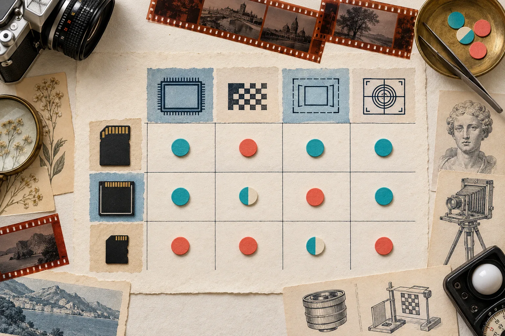
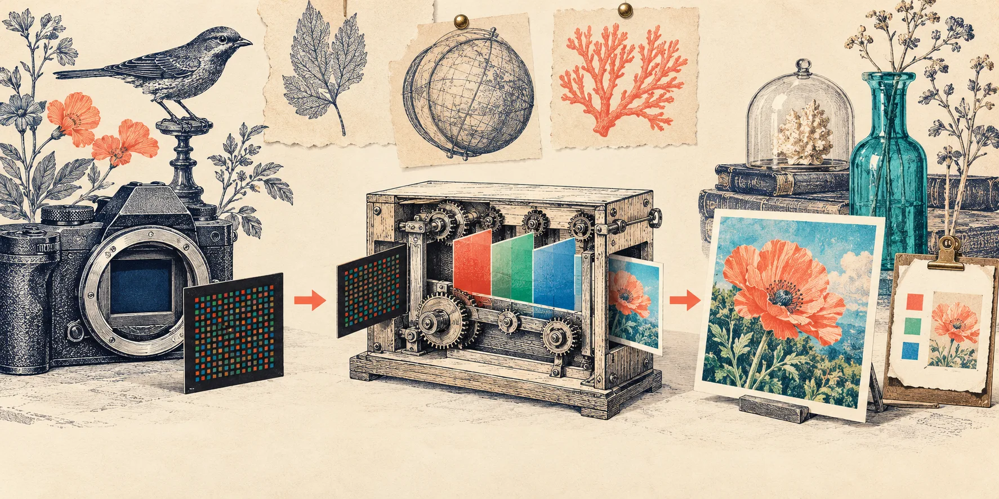
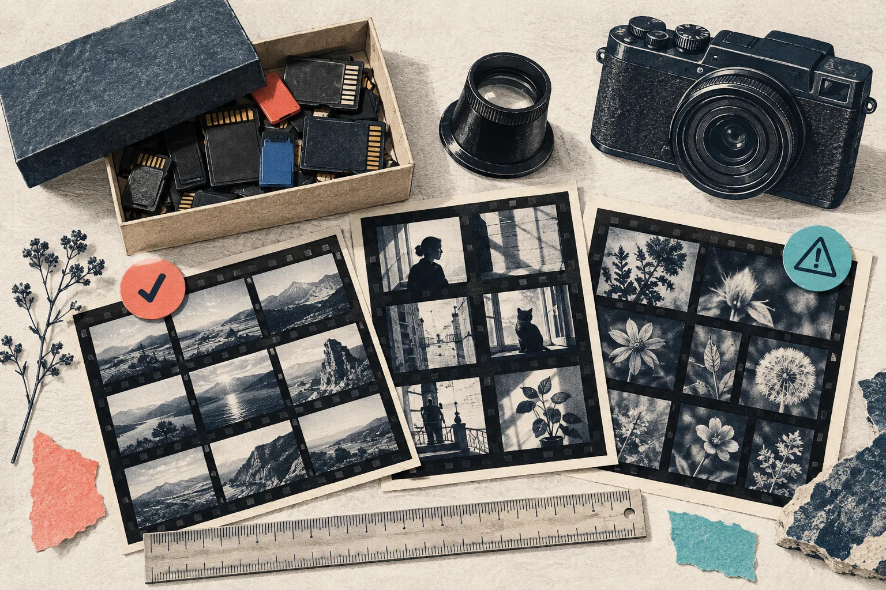

# Comment Vérifier la Compatibilité RAW Avant de Choisir un Décodeur

Avant d’intégrer un décodeur RAW, ne demandez pas seulement s’il ouvre des fichiers `.CR3`, `.NEF` ou `.ARW`. La bonne question est : **ouvre-t-il les fichiers, les modes et le rendu dont votre produit a réellement besoin ?** Un court jeu de fixtures, une matrice de décisions et une vérification du chemin de sortie évitent de découvrir trop tard qu’un fichier d’un client, un recadrage ou une compression particulière fait tomber le flux.

C’est justement l’intérêt de [FlashRaw](https://flashraw.ybouane.com/), un décodeur RAW open source écrit en Rust : sa documentation traite le support comme une matrice par format, mode, profondeur et compression, au lieu de promettre qu’une extension suffit. Voici une méthode praticable avant d’ajouter n’importe quel décodeur à une application web, un outil d’ingestion ou un traitement par lots.



## Une extension ne décrit pas un fichier RAW

Deux fichiers `.NEF` ou `.CR3` peuvent demander des chemins techniques différents : compression, profondeur, mode rafale, recadrage ou données à plusieurs images. C’est la raison pour laquelle il faut lire une table de support avant de parler de compatibilité. La [matrice de formats de FlashRaw](https://github.com/ybouane/flashraw/blob/main/docs/formats.md) distingue par exemple les modes vérifiés, partiels, expérimentaux et explicitement refusés.

La table rappelle aussi une réalité utile : un décodeur peut connaître le conteneur mais ne pas décoder un mode précis. Chez FlashRaw, les NEF Nikon High Efficiency sont, par exemple, détectés mais non décodés ; certains cas peuvent néanmoins laisser les métadonnées et les aperçus accessibles. Ce n’est pas une faiblesse à cacher : c’est une information qui permet de concevoir une erreur utile, plutôt qu’un téléversement qui échoue sans explication.

Pour une première passe, rassemblez :

- un fichier par boîtier réellement utilisé ;
- un échantillon par compression et taille de capture ;
- un fichier problématique connu ou volontairement non pris en charge ;
- un RAW avec orientation, balance des blancs et recadrage actifs ;
- si votre flux l’utilise, un fichier dont l’aperçu intégré est important.

## La fiche de décision à remplir avant l’intégration

Voici la petite grille que je garderais à côté du backlog. Elle force à décider ce que « compatible » veut dire dans votre produit.

| Besoin produit | Fixture à essayer | Critère d’acceptation | Décision si échec |
| --- | --- | --- | --- |
| Aperçu rapide après import | RAW avec aperçu intégré | aperçu extrait sans décoder toute l’image | afficher un état « aperçu indisponible » |
| Inspection technique | RAW avec métadonnées riches | CFA, niveaux noir/blanc, orientation et WB disponibles | conserver le fichier, signaler les champs manquants |
| Image de travail | RAW représentatif de chaque boîtier | pixels capteur et géométrie cohérents | basculer vers un autre chemin de traitement |
| Image écran | mêmes fixtures, sortie RGB | orientation, couleurs et recadrage validés par comparaison | garder le résultat comme non final ou ajuster le pipeline |
| Robustesse | fichier malformé et mode non supporté | erreur claire, pas de blocage ni d’allocation déraisonnable | journaliser et refuser proprement |

Cette grille change aussi la conversation avec une équipe : on ne cherche plus « le meilleur décodeur », on cherche le comportement nécessaire à une étape précise. Si vous construisez un aperçu local, le guide sur [la validation des importations RAW dans le navigateur](https://how-to.the-lean-ecommerce.com/2026/10/27/how-to-validate-browser-camera-raw-uploads-before-building-a-previewer/) complète bien cette étape avec les limites de taille, de mémoire et de messages d’erreur.



## Tester le décodage et le rendu comme deux travaux différents

Un RAW décodé n’est pas automatiquement une image prête à afficher. Le décodage donne des échantillons de capteur et les métadonnées nécessaires à leur interprétation ; la sortie RGB demande ensuite un développement : dématriçage, balance des blancs, matrices couleur, recadrage, orientation et encodage.

C’est important dans une comparaison de bibliothèques. Les [benchmarks reproductibles de FlashRaw](https://github.com/ybouane/flashraw/blob/main/docs/benchmarks.md) séparent explicitement le décodage capteur de la conversion RAW-vers-RGB et de la sortie sRGB. Ils signalent aussi des contre-exemples selon le fichier et la machine. Gardez donc les chiffres comme point de départ, pas comme promesse universelle pour votre parc de caméras.

Pour chaque fixture, conservez deux validations séparées :

1. **Décodage** : le fichier est accepté, ses dimensions, son CFA et ses niveaux attendus sont présents.
2. **Rendu** : la sortie respecte l’orientation, le recadrage et une cible de couleur décidée par votre application.

Cette séparation évite le faux positif classique : « ça marche » signifie seulement qu’aucune exception n’a été levée. Pour un projet web, une architecture avec worker garde la page disponible pendant le travail lourd ; notre guide sur [un aperçu RAW privé avec Web Workers](https://how-to-blog.gitlab.io/2026/10/27/how-to-build-a-private-browser-raw-preview-with-web-workers/) détaille ce découpage sans confondre confidentialité locale et compatibilité garantie.

## Une intégration minimale, mais avec un contrat clair

FlashRaw propose des chemins Rust, C/C++, Python, CLI et JavaScript/WebAssembly. Choisissez d’abord le chemin qui correspond à l’endroit où les octets doivent vivre : navigateur, worker, service Node, script Python ou application native. Par exemple, l’installation JavaScript commence simplement par :

```bash
npm install flashraw
```

Mais ne laissez pas cette ligne devenir votre spécification. Notez dans le ticket d’intégration : format d’entrée, sortie attendue (aperçu, pixels capteur ou RGB), limite de mémoire, stratégie pour les modes inconnus et fixtures versionnées. Les déploiements avec WASM multithreadé exigent en outre des en-têtes d’isolation adaptés ; un prototype qui fonctionne en local peut donc demander une vérification supplémentaire avant production.

Si vous remplacez un pipeline LibRaw, le chemin de compatibilité C de FlashRaw est à considérer comme une transition source : il faut recompiler, tester le sous-ensemble d’API utilisé et comparer les sorties. Ce n’est pas un remplacement binaire magique. Le [guide de référence pour choisir un décodeur RAW](https://outils-et-tutoriels.gitlab.io/guides/2026/10/30/guide-de-reference-choisir-un-decodeur-raw-pour-une-application-photo/) aide à poser ces compromis de langage, licence et sortie avant de modifier l’existant.



## Le test qui vaut plus qu’une démo réussie

Ajoutez votre jeu de fixtures à la CI et faites échouer le test si le statut d’un fichier change sans décision explicite. Pour chaque image, enregistrez le boîtier, le mode, la compression, le résultat attendu, la sortie demandée et la raison d’un éventuel refus. N’ajoutez pas de fichiers confidentiels au dépôt : utilisez des originaux dont vous avez les droits, des échantillons publics ou des hashes de sortie quand le corpus doit rester privé.

À ce stade, les résultats vous donnent une décision honnête : adopter le décodeur pour un sous-ensemble bien défini, prévoir un repli, ou attendre la prise en charge d’un mode critique. Cette même discipline sert ensuite quand les photos arrivent dans un catalogue ; pour la dernière étape côté marchand, voyez aussi [la checklist d’export de photos produit pour Shopify](https://tools-and-how-tos.github.io/2026/11/01/a-practical-product-photo-export-checklist-for-shopify-listings/).

## La prochaine action

Téléchargez la [documentation de support de FlashRaw](https://github.com/ybouane/flashraw/blob/main/docs/formats.md), choisissez cinq fichiers représentatifs et remplissez la grille ci-dessus avant d’écrire une ligne d’intégration. Si les cinq ont un résultat et une stratégie de repli clairs, vous avez déjà une base de décision bien plus solide qu’une démo qui ouvre un seul RAW.
