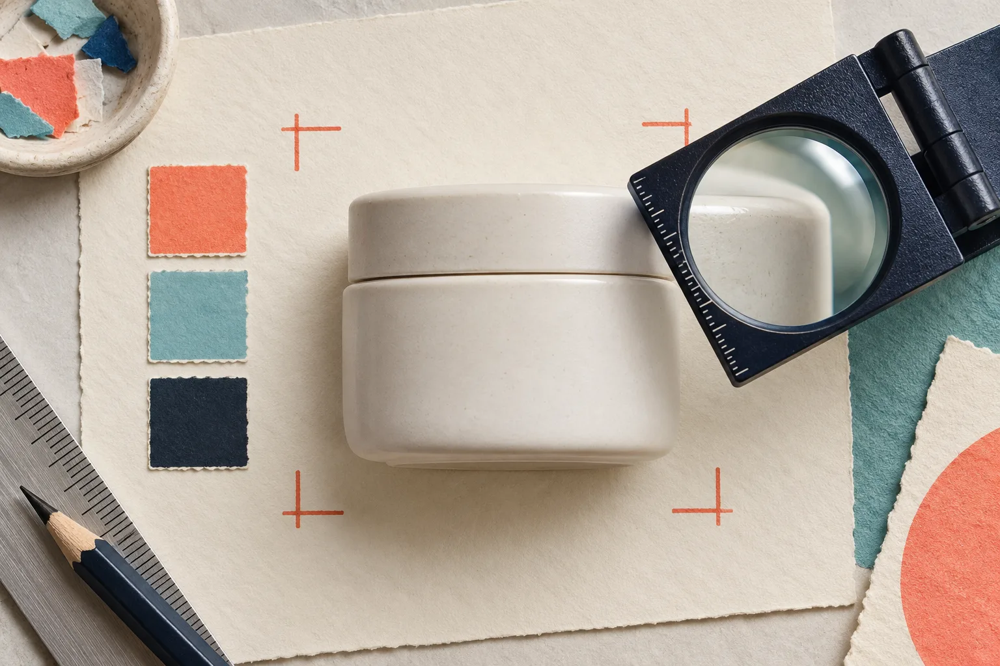
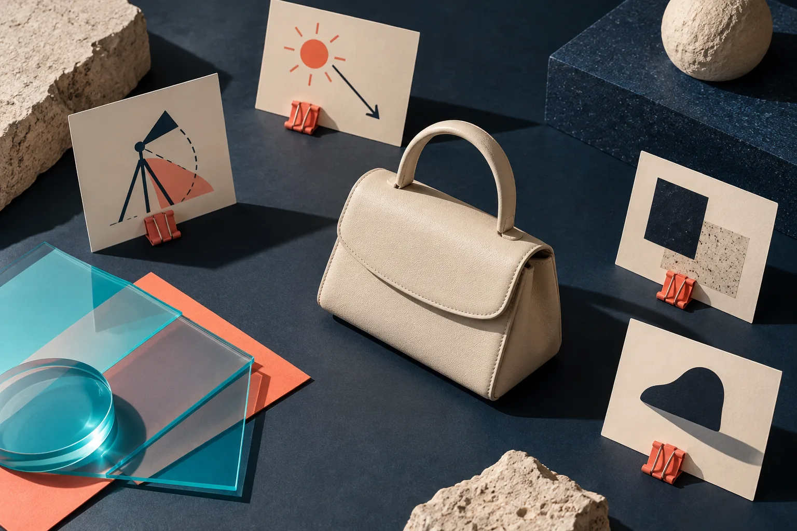
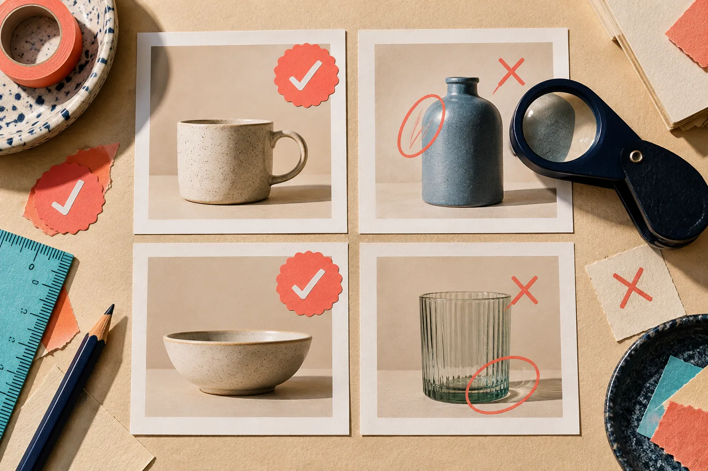

Les images lifestyle créées avec IA peuvent donner du contexte à un produit Shopify, mais elles ne doivent jamais réinventer sa forme, sa matière ou sa couleur. La méthode la plus sûre consiste à isoler d’abord le produit, verrouiller les variables du décor, puis comparer chaque rendu à la photo source avant publication. [Supra AI Photo Studio](https://apps.shopify.com/supra-ai-photo-studio) réunit précisément des outils d’isolation, d’amélioration et de mise en scène dans le flux Shopify ; le résultat mérite tout de même une vraie étape de contrôle.

## 1. Définir ce qui ne peut pas changer

Avant de choisir un décor, notez les éléments que la photo doit préserver : silhouette, teinte dominante, texture, nombre de pièces, position d’un motif et détail fonctionnel. Pour une paire de boucles d’oreilles, la forme de l’attache est aussi importante que l’éclat du métal ; pour un sac, ce sont souvent les coutures, le fermoir et les proportions.

Cette courte fiche est votre référence, pas une consigne esthétique. Elle évite de valider un joli visuel qui vend en réalité une variante inexistante. Shopify permet d’associer plusieurs médias à une fiche produit ; l’enjeu est donc que chaque média reste une représentation utile du même article, pas une nouvelle interprétation.

## 2. Partir d’une source nette et isolée

Une mise en scène ne corrige pas une source incertaine. Utilisez une photo où le produit est entier, net et éclairé sans dominante marquée. Si le fond distrait ou masque les bords, commencez par l’outil d’isolation. Dans Supra AI Photo Studio, l’isolation permet de donner à l’outil de placement un sujet plus lisible ; elle ne remplace pas une vérification des bords, des zones transparentes ou des détails fins.

Contrôlez cette source à 100 % avant d’aller plus loin :

- les contours ne sont ni amputés ni doublés ;
- la couleur est comparée à un échantillon ou à l’objet réel, pas seulement à l’écran ;
- les éléments inclus dans le lot sont visibles ;
- l’ombre existante n’est pas confondue avec le produit.

C’est une logique proche de celle expliquée dans notre guide sur [la préparation de photos produit sans Photoshop](https://outils-et-tutoriels.github.io/2026/10/13/comment-preparer-une-photo-produit-shopify-sans-installer-photoshop/) : améliorer un fichier est utile seulement si l’on sait ce que l’on protège.

## 3. Écrire un brief de décor à variables limitées

Le piège classique est de demander un « décor premium » et de laisser l’IA décider du reste. Préférez quatre paramètres concrets : surface, angle de caméra, direction de la lumière et usage suggéré. Par exemple : « flacon posé sur une tablette de salle de bain en pierre claire, vue trois-quarts, lumière de fenêtre venant de gauche, serviette blanche en arrière-plan ».

N’ajoutez qu’une variable créative à la fois. Vous saurez ainsi si une ombre, une matière ou une perspective altère le produit. Pour des vêtements ou accessoires portés, la même règle s’applique au modèle : taille du cadre, pose et éclairage doivent servir le produit, pas l’effacer.

## 4. Garder une petite bibliothèque de scènes compatibles

Au lieu de produire dix univers différents pour une même collection, préparez trois à cinq scènes réutilisables : table de travail, intérieur clair, situation d’usage, gros plan matière. Chaque scène reçoit son mini-brief et une image de référence. Cela donne une grille plus cohérente sur les pages produit et les collections.

Le principe aide aussi lorsque la couleur guide l’achat. Si vos produits existent en variantes, une image d’ambiance ne doit pas devenir votre seul repère visuel : consultez notre méthode pour [choisir des nuanciers Shopify fidèles à vos produits](https://outils-et-tutoriels.github.io/2026/10/19/comment-choisir-des-nuanciers-shopify-fideles-a-vos-produits/) avant de remplacer une vue de variante par une mise en scène.

## 5. Examiner le rendu avec une grille de fidélité

Après génération, ne vous contentez pas de demander si l’image est belle. Posez les questions ci-dessous, côte à côte avec la source.

| Vérification | Question à poser | Action si la réponse est non |
| --- | --- | --- |
| Forme | Les proportions et les bords correspondent-ils ? | Revenir à une source mieux isolée. |
| Couleur | La teinte reste-t-elle vendable et identifiable ? | Corriger ou conserver la vue studio. |
| Matière | Le tissu, le verre ou le métal reste-t-il crédible ? | Écarter le rendu trop lissé. |
| Contexte | Le décor explique-t-il un usage réel ? | Simplifier le brief de scène. |
| Cohérence | L’image s’accorde-t-elle avec le reste de la collection ? | Réutiliser une scène existante. |

Cette étape est différente d’un simple contrôle technique. Elle sert aussi à décider si l’image a sa place en fiche produit, en bannière de collection ou en publicité. Une scène spectaculaire peut être excellente pour une campagne, mais trop ambiguë comme image principale.

## 6. Publier d’abord sur un petit échantillon

Commencez par trois à cinq références avec des produits faciles à comparer. Observez sur mobile, sur la page collection et dans le panier : l’objet reste-t-il reconnaissable lorsque l’image est réduite ? Les variantes semblent-elles cohérentes ?

Si vous devez ajouter des informations à la fiche, évitez d’empiler visuels et texte. Un système de [détails produit mobile-first](https://outils-et-tutoriels.github.io/2026/10/04/organiser-contenu-produit-shopify-onglets-accordeons/) laisse à l’image son rôle — montrer — et aux accordéons celui d’expliquer.

## 7. Conserver les versions et les décisions

Gardez la photo source, le brief, le rendu retenu et une note indiquant pourquoi il a été validé. Cette trace rend les retouches plus rapides et évite qu’un visuel de campagne remplace par erreur une image cataloguée. Pour les équipes qui préparent beaucoup de fichiers, notre [checklist de contrôle avant export](https://tools-and-how-tos.github.io/2026/10/27/how-to-check-a-psd-handoff-before-exporting-ecommerce-assets/) fournit une bonne logique de vérification, même si elle porte sur un autre format.

## Quand Supra AI Photo Studio est le bon outil

Supra AI Photo Studio est pertinent si vous voulez partir de photos existantes pour retirer un arrière-plan, améliorer une image, placer un objet dans une scène ou tester une présentation sur modèle, directement depuis un flux Shopify. Consultez la [page de l’application](https://apps.shopify.com/supra-ai-photo-studio) pour les fonctionnalités et limites du plan qui vous concernent.

En revanche, gardez une prise de vue traditionnelle pour les images où une nuance exacte, une finition complexe ou une conformité réglementaire doit être démontrée sans interprétation. L’IA accélère la création de contexte ; elle ne doit pas devenir une promesse visuelle que votre produit ne peut pas tenir.

Commencez par une seule fiche produit : isolez une photo propre, rédigez un brief à quatre variables, puis ne publiez le rendu que lorsqu’il passe la grille de fidélité. C’est une façon simple de gagner des images lifestyle sans perdre la confiance construite par votre catalogue.
