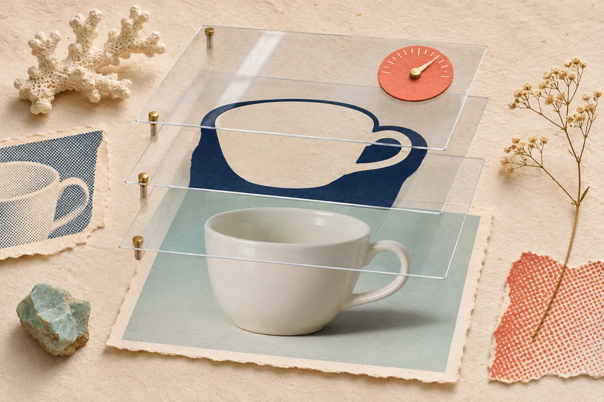

# Comment Remettre une Photo Produit Retouchable à un Client

Remettre une photo produit retouchable ne consiste pas à envoyer le plus gros fichier possible. Il faut livrer deux choses distinctes : un **master éditable** pour les corrections futures et un **export prêt à publier** qui montre le produit avec fidélité. Avec un éditeur à calques comme [ImageFlow](https://imageflow.dev/), ce duo peut être préparé directement dans le navigateur, à condition de séparer le travail, la vérification et l’export.

Cette méthode convient à une petite équipe e-commerce, à un photographe qui transmet une version corrigée ou à une boutique qui veut conserver ses options sans repartir de zéro à la prochaine campagne. Elle ne remplace pas une charte couleur, un bon éclairage ni un contrôle sur l’objet réel. Son but est beaucoup plus simple : rendre la prochaine modification sûre.

## Le vrai livrable : un master, un export, une note

J’utilise une règle de trois. Le fichier qui sert à modifier l’image, celui qui part sur la boutique et le bref mode d’emploi ne répondent pas au même besoin. Les confondre est la manière la plus rapide de perdre des calques ou de republier une mauvaise version.

| Élément | À quoi il sert | Ce qu’il doit contenir |
| --- | --- | --- |
| Master | Revenir sur la retouche | Calques, masques, réglages et éléments éditables |
| Export | Mettre l’image en ligne | Une image aplatie, aux dimensions et au poids adaptés |
| Note de remise | Éviter l’ambiguïté | Nom du fichier, usage prévu et points à ne pas modifier |

Un PSD est souvent le bon format de master quand le client en utilise déjà. ImageFlow annonce l’import et l’export PSD, ainsi que les calques, masques, objets dynamiques et calques de réglage dans le navigateur. Pour un fichier complexe, ne promettez toutefois pas une compatibilité parfaite : ouvrez le fichier exporté, contrôlez les calques essentiels et gardez le master d’origine jusqu’à validation. Cette précaution complète les [six vérifications à faire avant de renvoyer un PSD modifié](https://outils-et-tutoriels.github.io/2026/10/18/6-verifications-avant-de-renvoyer-un-psd-modifie-a-votre-equipe/).

## 1. Dupliquez avant de toucher aux pixels

Commencez par une copie de travail clairement nommée. Ne travaillez pas sur l’unique original fourni par le client. Dans ImageFlow, placez les retouches sur des calques et préférez un masque à une gomme : on peut alors rétablir une zone, modifier un détourage ou réviser l’arrière-plan sans détruire les pixels source.

C’est particulièrement utile pour une ombre, un fond ou une correction de tonalité. Une étiquette, une couture, une transparence de verre ou le bord d’un emballage demandent une attention différente d’un arrière-plan uni. L’outil peut aider à sélectionner ou à retirer le fond, mais le résultat reste une proposition à relire, pas une preuve que le bord est juste. Si votre point de départ est un visuel généré, appliquez aussi les contrôles de fidélité décrits dans ce guide sur les [photos lifestyle Shopify avec IA](https://outils-et-tutoriels.github.io/2026/11/01/photos-lifestyle-shopify-ia-verifier-fidelite-produit/).

## 2. Limitez la retouche à ce que le produit peut tenir

Une photo de vente n’a pas besoin d’être spectaculaire ; elle doit éviter de surprendre après l’achat. Je garde cette frontière : corriger poussière, dominante légère, fond irrégulier ou élément parasite est raisonnable. Changer la couleur réelle, effacer une rayure structurelle, affiner une pièce ou inventer un accessoire ne l’est pas.

Pour un élément parasite, l’outil de remplissage contextuel peut faire gagner du temps, mais observez ensuite la texture et l’ombre à 100 %. Pour une correction plus modeste, un calque de réglage permet de modifier exposition, contraste ou couleur sans figer le choix. C’est une approche plus réversible que de multiplier les exports, et elle prolonge bien une [retouche locale dans le navigateur](https://outils-et-tutoriels.github.io/2026/10/17/comment-retoucher-une-photo-produit-localement-depuis-son-navigateur/).

## 3. Faites le contrôle en quatre points avant l’export

Avant d’exporter, ouvrez l’image à sa taille utile et passez cette mini-fiche :

1. **Contour** — les bords fins, anses, cheveux, transparences et coins ne sont ni mangés ni entourés d’un halo.
2. **Identité** — texte, logo, matière, forme et accessoires visibles correspondent au produit vendu.
3. **Couleur** — le fond ou les réglages ne font pas dériver la teinte du produit ; comparez avec une référence réelle si la couleur est décisive.
4. **Ombre et échelle** — l’ombre reste plausible et le cadrage ne donne pas une impression trompeuse de taille.

Cette dernière passe est plus importante que le choix de l’outil. Shopify rappelle que les médias produits sont visibles publiquement et qu’il ne faut pas y déposer de documents confidentiels ; ne joignez donc jamais une note client ou un fichier de production sensible à la médiathèque. Sa documentation couvre aussi l’ajout de texte alternatif aux médias : préparez un alt descriptif au moment de la remise plutôt que de laisser ce champ vide.

## 4. Exportez pour un emplacement précis

Un export sans destination est difficile à évaluer. Notez au moins : `produit-angle-usage-dimensions-v01`. Par exemple, `tasse-bleue-face-fiche-produit-1600px-v01.jpg` est plus utile que `final2.jpg`. Exportez ensuite une version correspondant réellement à la fiche, à la collection ou à la campagne.

Si une variante doit être recadrée, traitée ou utilisée dans un autre format, repartez du master plutôt que d’un JPEG déjà compressé. C’est le principe développé dans ce guide pour [créer des variantes d’images Shopify sans remplacer le master](https://tools-and-how-tos.github.io/2026/11/02/how-to-make-shopify-product-image-variants-without-replacing-the-maste/).

## 5. Remettez les fichiers de façon lisible

Le message de remise peut tenir en trois lignes :

> Master : `produit-master-retouche.psd` — calques et masque conservés.  
> Export : `produit-fiche-1600px.jpg` — destiné à la fiche produit.  
> À contrôler : la couleur sur écran et le texte alternatif avant publication.

Cette petite note évite qu’un collègue publie par erreur le fichier de travail, ou qu’il écrase le master avec un export aplati. Elle rend également la prochaine demande — un nouveau fond, une autre langue, une bannière de collection — beaucoup moins coûteuse.

## Une remise qui laisse des options

ImageFlow est intéressant lorsque vous avez besoin de conserver des calques et des masques sans installer d’application de bureau : ouvrez [une vraie photo dans ImageFlow](https://imageflow.dev/), faites une seule correction réversible, puis produisez un master et un export distincts. Si le détour, la couleur ou le PSD doit alimenter une production critique, ajoutez un contrôle humain sur le fichier final. La bonne remise n’est pas celle qui paraît la plus sophistiquée ; c’est celle qui permet de corriger demain sans déformer ce que l’acheteur verra aujourd’hui.
