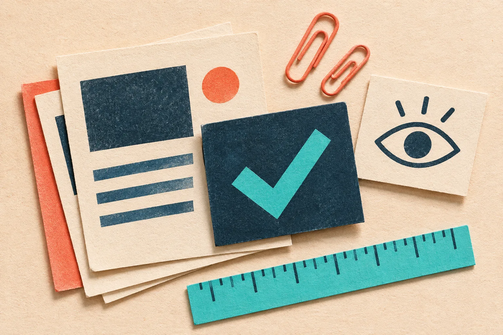

# Comment vérifier le contraste de vos couleurs avant de publier une page

Le contraste ne se vérifie pas à l’œil, surtout quand une couleur paraît très nette sur votre écran et devient hésitante dans un bouton, un texte discret ou une bannière vue dehors. Avant de publier, contrôlez chaque paire *texte/fond* et les états importants avec un outil de contraste, puis relisez la page dans son vrai contexte. Cette petite étape évite de découvrir trop tard qu’un appel à l’action ou une information utile se perd.

Pour ce contrôle, le [Color Contrast Checker de Tiny Online Tools](https://tiny-online.tools/design-tools/color-contrast-checker) donne un point de départ immédiat dans le navigateur. Le site se présente comme une collection d’outils sans compte ni téléversement ; c’est pratique pour tester une palette, un extrait de CSS ou une couleur relevée sans ouvrir un logiciel de design.

## Commencez par la bonne question

Le piège est de demander : « Est-ce que ces deux couleurs sont jolies ensemble ? » C’est une bonne question de direction artistique, mais pas encore une question de lisibilité. Demandez plutôt : **qui doit lire quoi, sur quel fond, dans quelle taille et dans quel état ?**

Prenez une page réelle : un titre sombre sur fond clair, un paragraphe secondaire, un bouton corail, son texte, puis ses versions survolée, désactivée ou sélectionnée. Ce sont des paires distinctes. Une palette peut être cohérente et produire tout de même un libellé discret presque invisible.

Voici la fiche que je garde avant une publication :

| Élément | Paire à tester | Décision utile |
| --- | --- | --- |
| Texte courant | couleur du texte + fond réel | lisible ou à assombrir |
| Petit libellé | couleur atténuée + fond | garder, renforcer ou supprimer |
| Bouton | texte + couleur du bouton | changer le texte ou le fond |
| Lien | lien + fond, puis lien visité | distinguer sans compter sur la couleur seule |
| État | survol, focus, erreur, désactivé | vérifier chaque état, pas seulement la maquette |

La dernière colonne importe plus que le score isolé : elle vous oblige à modifier une paire précise, plutôt qu’à refaire toute la charte.

## Relevez les couleurs sans les deviner

Copier une valeur depuis une maquette est idéal. Mais il arrive qu’un visuel soit déjà dans un document, une capture ou une page de test. Dans ce cas, utilisez le [sélecteur de couleurs d’image](https://tiny-online.tools/image-tools/image-color-picker) pour relever une teinte, puis passez-la dans le vérificateur de contraste. Si vous avez des formats différents sous la main, le [convertisseur de codes couleur](https://tiny-online.tools/utility-tools/color-code-converter) aide à remettre tout le monde d’accord avant le test.

Ne cherchez pas la nuance parfaite pendant vingt minutes. Choisissez d’abord les deux couleurs réellement affichées. Les variations d’opacité, une image derrière le texte ou une ombre légère changent le résultat perçu : le test doit donc porter sur la version publiée, pas sur l’intention.

## Faites un passage par ordre de risque

Je commence par ce qui empêche une action : bouton de commande, champ de formulaire, prix, échéance, message d’erreur. Ensuite viennent les éléments qui aident à comprendre : navigation, filtres, légendes, texte secondaire. Les détails décoratifs passent en dernier.

Cette séquence évite une correction classique mais coûteuse : éclaircir un texte parce qu’il semble plus élégant, puis découvrir que le bouton devient plus difficile à utiliser. Si une paire ne tient pas, il y a trois corrections simples : assombrir le texte, éclaircir le fond, ou réserver la couleur faible à un détail non essentiel. Ajouter seulement une ombre ou augmenter légèrement la graisse peut aider visuellement, mais ne remplace pas un vrai contrôle de la paire.

Un autre bon réflexe est de ne pas faire reposer un sens uniquement sur la couleur. Une erreur peut aussi avoir un message clair ; un statut peut aussi avoir une icône ou un libellé. Cette redondance rend la page plus compréhensible sans la rendre plus lourde.

## Vérifiez la page, pas seulement des carrés de couleur

Après les paires, ouvrez la prévisualisation sur un écran moins flatteur : luminosité réduite, fenêtre étroite, ou simplement quelques pas de recul. Cherchez le premier élément qui vous demande un effort. C’est souvent un texte secondaire, un lien placé dans un paragraphe ou une étiquette dans une photo.

Cette étape rejoint deux contrôles utiles avant publication : [relire une mise à jour technique avant de la transformer en post X](https://outils-et-tutoriels.github.io/2026/11/06/transformer-une-mise-a-jour-technique-en-post-x-qui-lance-une-vraie-di/) évite de perdre le message ; [vérifier les métadonnées d’un PDF avant partage](https://outils-et-tutoriels.github.io/2026/10/28/comment-nettoyer-les-metadonnees-d-un-pdf-avant-de-le-partager/) évite de livrer une information involontaire. Dans les deux cas, une courte relecture du livrable final vaut mieux qu’une hypothèse fondée sur le fichier source.

## Une routine de deux minutes à garder

Avant de cliquer sur Publier, faites ceci :

1. Listez les textes, liens et boutons qui comptent vraiment.
2. Testez leur couleur contre leur fond réel dans le [vérificateur de contraste](https://tiny-online.tools/design-tools/color-contrast-checker).
3. Corrigez une paire à la fois et contrôlez les états du composant.
4. Relisez la page complète, y compris les messages d’erreur et les liens dans le texte.
5. Gardez les couleurs validées dans votre petite bibliothèque de projet.

Si votre projet doit répondre à des exigences réglementaires ou contractuelles précises, cette routine ne remplace pas un audit adapté au contexte. Elle crée en revanche une habitude saine : vérifier ce que les visiteurs lisent réellement. Pour finir le contrôle sans changer d’environnement, ouvrez [Tiny Online Tools](https://tiny-online.tools/) et testez la première paire critique de votre prochaine page.
