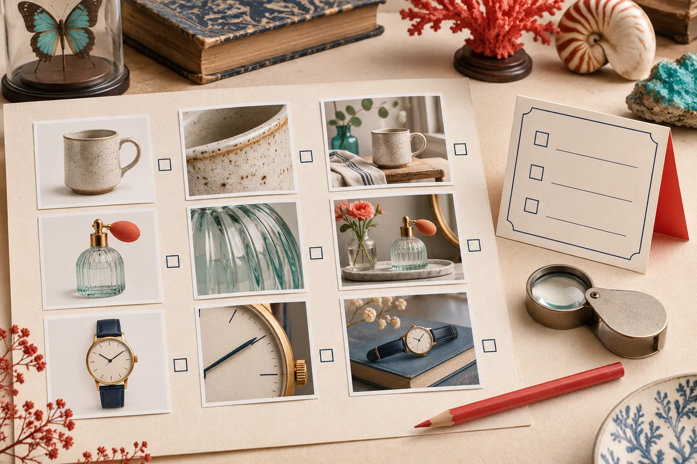
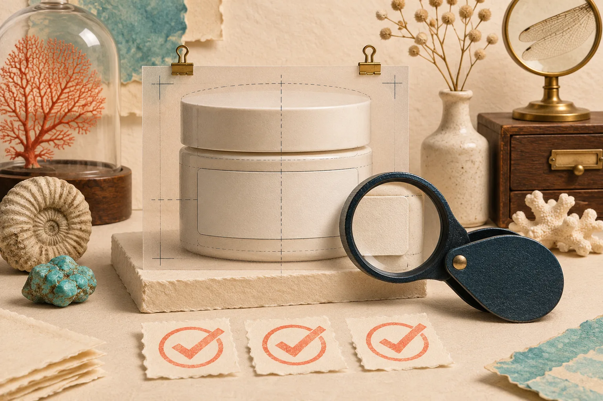
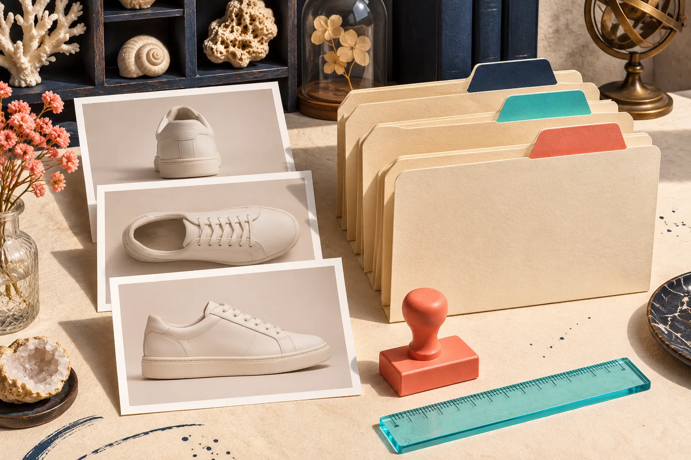

# Quelles Images IA Garder sur une Fiche Produit Shopify ?

Vous n’avez pas besoin de publier toutes les variantes créées par IA. Sur une fiche Shopify, gardez d’abord une image qui décrit le produit sans ambiguïté, puis ajoutez seulement les vues qui répondent à une question d’achat : détail, échelle, usage ou contexte. Conservez l’original séparément : il reste votre point de comparaison si une version générée s’écarte du produit réel.

C’est une distinction utile dès qu’une série d’essais commence à produire plus d’images que la fiche ne peut en expliquer. [Supra AI Photo Studio](https://apps.shopify.com/supra-ai-photo-studio) propose notamment la suppression ou le remplacement d’arrière-plan, l’amélioration d’image, les scènes lifestyle et les essayages virtuels. Ces possibilités sont intéressantes, mais elles ne donnent pas automatiquement à chaque résultat une place dans la galerie.

## La règle simple : une image, une question résolue

Avant d’ajouter une variante, posez-lui une seule question : **qu’est-ce qu’elle permet de comprendre que la photo précédente ne montre pas déjà ?** Si la réponse est « elle est plus jolie », elle a peut-être sa place dans une publicité, pas forcément dans la fiche.

Je classe les images en quatre rôles :

| Rôle | Question acheteur | Place dans la galerie |
| --- | --- | --- |
| Référence | « Qu’est-ce que je reçois ? » | Première ou deuxième image |
| Détail | « Quelle est la matière, la finition, la coupe ? » | Après la référence |
| Contexte | « À quoi cela ressemble-t-il en situation ? » | Après les preuves produit |
| Inspiration | « Quelle ambiance peut créer ce produit ? » | Dernière image, si elle n’ajoute pas de confusion |

La vue de référence mérite une attention particulière. Shopify indique que le premier média est le média principal : il apparaît notamment dans les collections, le panier, le passage en caisse et la page d’accueil. [Choisir et réordonner le média principal](https://help.shopify.com/en/manual/products/product-media/add-media) n’est donc pas une décision décorative. Pour un produit physique, je réserverais cette place à une image où la forme, la couleur et les éléments vendus restent lisibles.

## Commencer par une source qu’on peut défendre

Prenez la meilleure photo existante : fond simple, produit net, cadrage qui ne coupe pas une caractéristique utile. Dans Supra AI Photo Studio, l’éditeur permet de sélectionner une image du produit avant d’utiliser les outils de retouche ou de génération. L’[aide de l’application](https://supra-ai-photo-studio.sktch.io/) recommande aussi de partir d’images suffisamment définies et d’isoler le produit lorsque cela aide l’outil à se concentrer sur lui.

L’original ne doit pas forcément apparaître dans la galerie finale, mais il doit rester sauvegardé. Le Centre d’aide Shopify recommande d’enregistrer les modifications d’image comme nouveau fichier pour préserver l’original. C’est la bonne habitude ici : ne remplacez pas votre seul point de référence par une version IA. Si vous partez d’un fichier délicat, ce guide sur [la préparation d’une photo produit sans Photoshop](https://outils-et-tutoriels.github.io/2026/10/13/comment-preparer-une-photo-produit-shopify-sans-installer-photoshop/) aide aussi à rendre la source exploitable avant la génération.

Si votre photo de départ réclame surtout une correction de lumière, de netteté ou d’arrière-plan, traitez-la comme une correction. Si vous créez une scène de cuisine, une image portée ou un décor éditorial, traitez-la comme une interprétation. Ces deux catégories ne répondent pas à la même question client.

## Le test de fidélité en trois minutes

Une image contextuelle réussie peut tout de même introduire un mauvais détail : une fermeture différente, une texture trop lisse, une couleur déplacée ou un accessoire qui n’est pas inclus. Avant publication, comparez la variante avec l’original, côte à côte.

Utilisez cette micro-checklist :

- La silhouette, les proportions et le nombre d’éléments sont-ils identiques ?
- La couleur reste-t-elle plausible sous cette lumière ?
- La matière est-elle cohérente avec la photo source ?
- Un détail généré peut-il faire croire qu’un accessoire est vendu avec le produit ?
- L’image apporte-t-elle une information que les autres vues n’apportent pas ?

Au moindre doute sur un attribut acheté, retirez l’image de la fiche ou déplacez-la dans un usage d’inspiration explicitement légendé. Cette discipline prolonge la méthode détaillée dans [Photos lifestyle Shopify avec IA : vérifier la fidélité du produit](https://outils-et-tutoriels.github.io/2026/11/01/photos-lifestyle-shopify-ia-verifier-fidelite-produit/).

## Composer une galerie courte plutôt qu’un défilement de variantes

Pour une petite fiche, cinq vues bien distribuées valent mieux que quinze décors proches. Voici un ordre réutilisable :

1. La photo de référence, nette et sans surprise.
2. Un angle ou un détail matériel.
3. Une vue à l’échelle, portée ou placée dans un intérieur lorsque cela aide réellement.
4. Une scène lifestyle générée, si elle montre un usage précis.
5. Une vue finale facultative : emballage, variante ou inspiration.

Cette séquence protège l’acheteur de l’effet catalogue incohérent. Elle protège aussi l’équipe : une image générée n’est plus « la belle version », mais une pièce qui doit accomplir une fonction. Si vous devez d’abord remettre un fichier propre à un collègue ou à un client, lisez aussi [Comment remettre une photo produit retouchable à un client](https://outils-et-tutoriels.github.io/2026/11/03/comment-remettre-une-photo-produit-retouchable-a-un-client/).

## Nommer les variantes pour pouvoir revenir en arrière

Ne laissez pas des fichiers nommés `final-final-2`. Créez un nom qui indique le produit, le rôle et la version : `bougie-ambre_reference-v1`, `bougie-ambre_lifestyle-table-v2`, `bougie-ambre_detail-couvercle-v1`. Ajoutez une note courte sur le prompt ou l’intention, surtout lorsqu’une personne différente devra mettre à jour la fiche.

Ce rangement rend aussi les essais comparables. Quand vous [créez des variantes visuelles sans perdre l’original](https://outils-et-tutoriels.github.io/2026/10/20/comment-creer-des-variantes-visuelles-sans-perdre-votre-original/), vous pouvez écarter une ambiance sans effacer la vue qui sert de référence.

## Une première expérience raisonnable avec Supra AI Photo Studio

Choisissez un seul produit simple et une seule question à résoudre : par exemple, « cette lampe paraît-elle à sa taille sur une table de chevet ? » Importez la source, créez une scène d’objet placée, puis gardez l’original et le résultat. Vérifiez les cinq points ci-dessus avant de publier.

L’application annonce des outils de retouche, d’objets placés en décor et de try-on ; les [fonctionnalités et limites de forfait](https://apps.shopify.com/supra-ai-photo-studio) évoluent, donc vérifiez l’offre courante avant de planifier une production en volume. Pour ce premier essai, le résultat recherché n’est pas une galerie spectaculaire : c’est une image qui aide une personne à décider.

En résumé : faites de l’original votre référence, donnez un rôle clair à chaque variante et publiez seulement les images qui réduisent une hésitation réelle. Ouvrez une fiche produit cette semaine, gardez trois à cinq images avec une mission distincte, puis testez une seule scène IA dans [Supra AI Photo Studio](https://apps.shopify.com/supra-ai-photo-studio).
