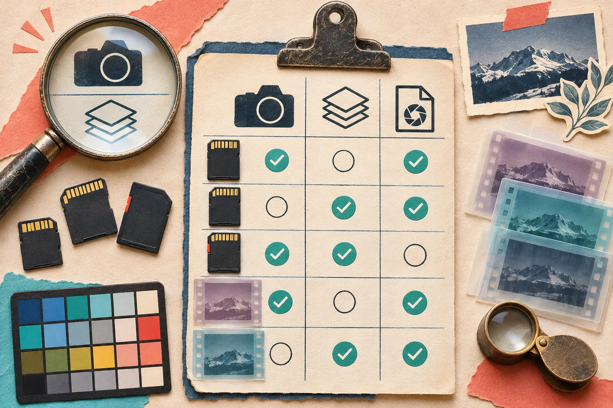

# Prévisualiser des RAW dans le navigateur sans confondre aperçu et rendu final

Quand un photographe dépose un fichier RAW dans votre outil, il veut d’abord savoir si c’est le bon cliché — pas attendre que l’application produise une image définitive. La bonne architecture consiste à afficher rapidement l’aperçu intégré lorsque le fichier en contient un, puis à réserver le décodage et le développement RAW complet à une action explicite ou à une étape de fond. C’est plus réactif, mais cela impose de dire clairement ce que l’utilisateur regarde.

[FlashRaw](https://flashraw.ybouane.com/) est un composant open source pour ouvrir et décoder des RAW en Rust, JavaScript/WebAssembly, Python, C et C++. Son package JavaScript peut fonctionner dans le navigateur, un Web Worker ou Node.js. Avant de le choisir, vérifiez néanmoins le **boîtier, le mode de compression et le résultat attendu** : une extension `.NEF` ou `.DNG` ne constitue pas, à elle seule, une promesse de compatibilité.


## Le contrat à afficher avant le premier pixel

Un RAW contient des échantillons de capteur et des métadonnées ; une image affichable demande ensuite des choix de dématriçage, balance des blancs, colorimétrie et rendu. L’aperçu JPEG embarqué, lui, est souvent une représentation produite par le boîtier. Il peut être très utile pour trier, mais il n’est pas la preuve que votre rendu final sera identique.

Je poserais ce contrat produit dès l’interface :

| Besoin | Chemin à privilégier | Ce que vous devez annoncer |
| --- | --- | --- |
| Choisir une photo vite | aperçu embarqué | aperçu boîtier, pas un rendu édité |
| Lire boîtier, ISO, orientation | ouverture + métadonnées | informations lues dans le fichier |
| Zoomer et retoucher | décodage RAW puis RGB | calcul plus long, dépendant du navigateur |
| Exporter | pipeline de rendu explicite | paramètres couleur et format documentés |

Cette séparation évite une erreur fréquente : lancer un lourd `decode()` sur le fil principal à chaque dépôt, puis appeler le résultat « aperçu ». Elle vous aide aussi à relier le bon outil à chaque étape. Pour l’inventaire des formats et de leurs limites, commencez par la [matrice de formats officielle](https://github.com/ybouane/flashraw/blob/main/docs/formats.md), pas par une liste d’extensions dans votre code.

## Un squelette JavaScript petit, mais honnête

Voici le parcours minimal documenté par FlashRaw. Pour une application réelle, déplacez ce travail dans un Worker avant de brancher l’interface utilisateur.

```js
import { FlashRaw } from 'flashraw';

const raw = await FlashRaw.open(file);
console.log(raw.metadata.camera.name, raw.metadata.exposure.iso);

const embedded = await raw.preview(); // JPEG embarqué, sans décodage RAW
// Affichez embedded dans votre composant d’aperçu.

const rgba = await raw.decode({ output: 'rgba8' });
// Utilisez rgba.toImageData() uniquement pour le chemin de rendu choisi.
raw.close();
```

Le point décisif n’est pas la syntaxe : c’est le déclencheur. L’ouverture permet d’inspecter le fichier ; `preview()` peut servir au tri ; `decode()` doit être déclenché parce que l’utilisateur veut réellement développer l’image. Gardez une limite de taille, annulez le travail lorsque l’utilisateur choisit un autre fichier et libérez la ressource avec `close()`.

## Le Worker est une frontière d’expérience, pas un autocollant de performance

Un Worker évite de bloquer les interactions pendant les opérations coûteuses, mais ne rend pas les fichiers plus petits ni tous les appareils équivalents. Faites passer un message simple : « fichier reçu », « aperçu prêt », « rendu en cours », puis « rendu prêt » ou « format non pris en charge ».

Pour les navigateurs compatibles, FlashRaw propose aussi SIMD WebAssembly, du multithreading lorsque la page est isolée cross-origin et un chemin WebGPU optionnel. Ce sont des options à mesurer sur votre cible de déploiement, pas une raison d’afficher une promesse de vitesse universelle. La [documentation des benchmarks](https://github.com/ybouane/flashraw/blob/main/docs/benchmarks.md) sépare les charges de décodage et de RAW-vers-RGB, documente les machines et les corpus, et signale des cas où d’autres décodeurs vont plus vite. C’est exactement le niveau de preuve à exiger avant de comparer deux bibliothèques.



## Votre test de compatibilité doit ressembler à vos clients

La documentation de FlashRaw suit le support par **format et mode** : profondeur de bits, compression et recadrage comptent. Elle indique par exemple que certains NEF Nikon High Efficiency sont détectés mais non décodés, tandis que des métadonnées et aperçus peuvent rester accessibles. Ne transformez donc pas un test positif sur un seul NEF en promesse « Nikon pris en charge ».

Préparez une petite valise de fichiers, obtenus légalement :

1. les trois boîtiers réellement utilisés par votre audience ;
2. une variante compressée et une non compressée lorsqu’elles existent ;
3. un fichier très grand qui révèle la pression mémoire ;
4. un fichier volontairement tronqué, pour vérifier l’erreur et non seulement le succès ;
5. un témoin dont vous connaissez le rendu de référence.

Pour chaque fichier, notez séparément : ouverture, métadonnées, aperçu intégré, décodage, durée perçue, mémoire et rendu visuel. Si vous avez déjà une chaîne d’images côté navigateur, notre guide sur [la retouche locale depuis le navigateur](https://outils-et-tutoriels.github.io/2026/10/17/comment-retoucher-une-photo-produit-localement-depuis-son-navigateur/) aide à conserver cette même exigence de confidentialité et de contrôle.

## La checklist de mise en ligne


Avant de déclarer la fonction prête, cochez ces décisions :

- L’interface précise-t-elle « aperçu embarqué » lorsqu’elle ne montre pas encore votre rendu ?
- Le décodage tourne-t-il hors du fil d’interface, avec annulation et retour d’erreur ?
- Avez-vous testé vos propres boîtiers, compressions et tailles de fichier ?
- Vos limites de taille, de mémoire et de temps sont-elles visibles et mesurées ?
- Les en-têtes nécessaires au multithreading WebAssembly ont-ils été vérifiés dans le déploiement réel ?
- Votre export utilise-t-il un chemin de rendu documenté, plutôt qu’une capture de l’aperçu ?

FlashRaw met l’accent sur l’analyse mémoire sûre de fichiers non fiables et sur des contrôles de bornes ; c’est une bonne fondation, pas une excuse pour retirer vos propres limites d’upload, tests de fichiers malformés ou messages d’échec. De même, le GPU peut être pertinent pour certains développements, mais le navigateur, la mémoire et le format déterminent encore le résultat.

## Commencez par un petit contrat, puis mesurez

Pour un premier lancement, je ferais volontairement moins : accepter quelques boîtiers documentés, afficher l’aperçu embarqué, proposer le rendu complet à la demande et enregistrer les échecs anonymisés par format. Vous obtiendrez une fonction immédiatement utile sans confondre tri visuel et fidélité colorimétrique.

Installez `flashraw`, testez votre propre valise de RAW et publiez une page de compatibilité qui dit autant ce qui fonctionne que ce qui reste à vérifier. C’est plus crédible — et beaucoup plus agréable à utiliser — qu’un bouton « importer un RAW » qui promet trop.
