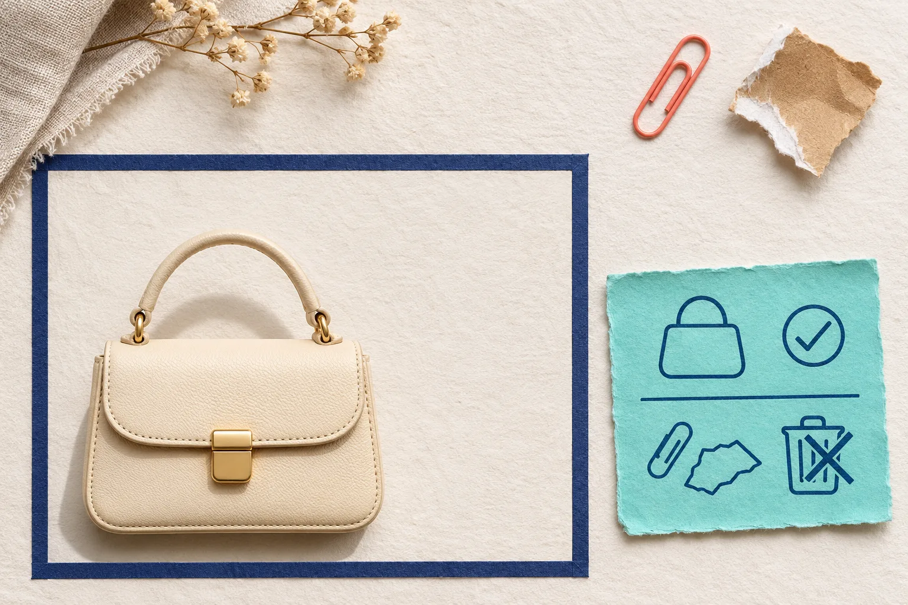
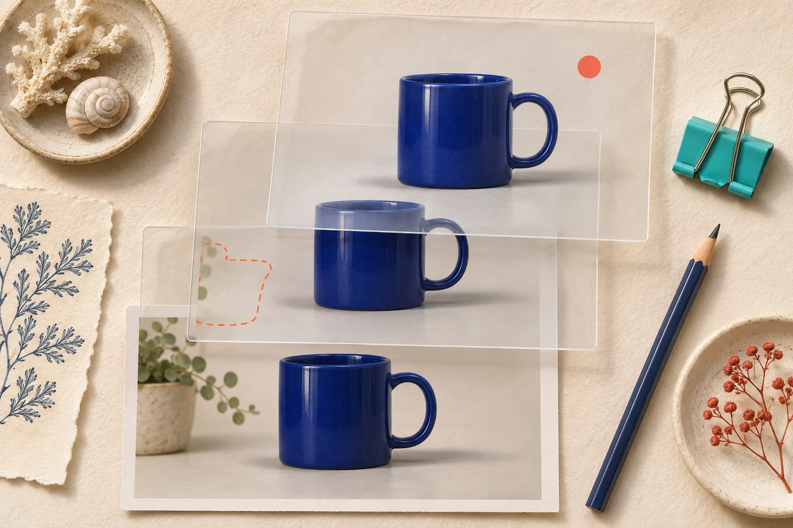

# Retirer un objet parasite d’une photo produit sans tromper vos clients

Un câble qui traverse le fond, une étiquette oubliée, une miette sur le support : oui, vous pouvez nettoyer ce type de parasite. La règle utile est simple : ne retirez que ce qui n’appartient ni au produit, ni à son usage, ni à la promesse faite à l’acheteur. Travaillez sur un calque, vérifiez à 100 %, puis comparez l’export à l’original.

C’est exactement le genre de petite correction que permet [ImageFlow](https://imageflow.dev/), un éditeur d’images dans le navigateur avec calques, masques, réglages et remplissage d’après le contenu. Son intérêt n’est pas de fabriquer une nouvelle version séduisante du produit : c’est de conserver un document modifiable pendant que vous retirez un accident de prise de vue.

## Commencez par décider : parasite ou information ?

Avant de toucher aux pixels, posez-vous une question plus précise que « est-ce moche ? » : **cet élément changerait-il ce qu’un client comprend du produit ?** Si la réponse est oui ou incertaine, ne le supprimez pas.

| Élement visible | Le retirer ? | Pourquoi |
| --- | --- | --- |
| Poussière, reflet d’un trépied, câble hors produit | Généralement oui | C’est un incident de studio, sans rapport avec l’article vendu. |
| Ombre propre au produit | Avec prudence | Elle décrit souvent son volume et son contact avec le sol. |
| Étiquette, couture, rayure, accessoire inclus | Non | Cela peut modifier l’état, la matière ou le contenu de l’offre. |
| Décor qui masque une zone du produit | Non sans nouvelle prise | Le correctif risque d’inventer une forme ou une texture. |

Cette distinction évite le piège du « nettoyage » qui devient retouche trompeuse. Shopify rappelle d’ailleurs que les fichiers mis dans son espace public doivent être destinés à être visibles sur la boutique : traitez donc l’image finale comme une information commerciale, pas comme une simple décoration. [La documentation sur les médias produit](https://help.shopify.com/en/manual/products/product-media) est un bon rappel du contexte de publication.

## La méthode en quatre gestes, sans écraser l’original

1. **Dupliquez le calque photo et nommez-le.** Gardez le fichier original en bas, puis une copie « nettoyage fond » au-dessus. Cette discipline rend le choix réversible et facilite une validation par une autre personne.
2. **Sélectionnez d’abord le parasite, pas tout le décor.** Un masque serré ou la sélection d’objet doit englober le câble ou le débris, sans mordre sur le contour du produit. Pour un bord complexe, agrandissez avant de confirmer : métal brillant, verre, cheveux, tissage et transparence demandent rarement une sélection automatique parfaite.
3. **Appliquez le remplissage sur la copie.** ImageFlow propose la sélection d’objet, les masques et le remplissage d’après le contenu dans le navigateur. Utilisez-les sur la petite zone définie ; si le résultat recrée un motif répétitif ou une ombre invraisemblable, annulez et réduisez la sélection.
4. **Alternez visibilité et zoom.** Cachez puis affichez le calque de correction à 100 % et à taille d’usage. Vous devez retrouver le même produit, la même étiquette, les mêmes bords et la même ombre utile.

## Le test des trois bords

Après une correction, je vérifie systématiquement trois frontières : le contour du produit, la limite de son ombre et la jonction entre le fond reconstruit et le fond intact. Une intervention passe rarement inaperçue sur ces lignes-là.

Un exemple concret : sur une bouteille de soin posée sur un papier crème, un bout de ruban apparaît à dix centimètres du flacon. Le retirer est raisonnable. En revanche, si le ruban recouvre une partie de l’étiquette ou son reflet dans le verre, le remplissage devrait deviner des caractères et de la matière. Mieux vaut refaire la photo ou conserver l’élément plutôt que de publier une reconstruction.

Cette logique complète le contrôle de fidélité présenté dans notre guide sur [les images IA à garder sur une fiche produit](https://outils-et-tutoriels.github.io/2026/11/10/quelles-images-ia-garder-sur-une-fiche-produit-shopify/). Même sans générer une image, une retouche localisée mérite la même question : le client verrait-il encore ce qu’il recevra ?

## Pourquoi les calques comptent davantage que le résultat immédiat

Le raccourci tentant est d’exporter dès que le fond paraît uniforme. Mais conserver le calque de correction, son masque et une version source rend votre décision vérifiable. C’est particulièrement précieux si une collègue demande pourquoi une ombre a changé, ou si vous devez décliner l’image pour une bannière, un e-mail et une fiche produit.

Voici un mini-registre de travail suffisant :

- fichier source et date de prise de vue ;
- élément retiré et raison ;
- zone masquée ou outil employé ;
- personne qui a validé l’export ;
- destination : fiche, collection, publicité ou réseau social.

Il prolonge une habitude utile : [remettre une photo produit retouchable à un client](https://outils-et-tutoriels.github.io/2026/11/03/comment-remettre-une-photo-produit-retouchable-a-un-client/) plutôt qu’un seul JPEG impossible à expliquer. Pour des déclinaisons, vous pouvez aussi repartir d’un master et suivre notre méthode pour [créer des variantes visuelles sans perdre l’original](https://outils-et-tutoriels.github.io/2026/10/20/comment-creer-des-variantes-visuelles-sans-perdre-votre-original/).

## Une sortie qui reste honnête et utile

Avant l’export, vérifiez ce court contrôle :

- Le produit, sa couleur, sa taille apparente et ses accessoires sont-ils identiques à la source ?
- Les bords, l’étiquette et les zones transparentes résistent-ils au zoom ?
- L’ombre reste-t-elle cohérente avec la lumière ?
- Le nom de fichier distingue-t-il la source, le document modifiable et l’export publié ?

Si l’une de ces réponses est non, revenez au masque ou refaites la prise. Cette minute de contrôle est moins coûteuse qu’une fiche dont la photo promet un produit différent. Les critères de contraste des objets graphiques expliqués par le [W3C](https://www.w3.org/WAI/WCAG22/Understanding/non-text-contrast.html) offrent aussi un bon réflexe pour les visuels explicatifs : les détails nécessaires à la compréhension doivent rester perceptibles, pas seulement jolis.

Pour un besoin plus large de retouche locale, relisez [comment retoucher une photo produit localement depuis son navigateur](https://outils-et-tutoriels.github.io/2026/10/17/comment-retoucher-une-photo-produit-localement-depuis-son-navigateur/). Puis ouvrez ImageFlow avec une vraie photo, choisissez un seul parasite clairement extérieur au produit, et gardez la correction sur son propre calque. C’est la plus petite expérience qui permet de gagner du temps sans perdre la confiance du client.

## Conclusion

Retirer un objet parasite est une correction de contexte, pas une permission de réinventer l’article. Une sélection étroite, un calque réversible et le test des trois bords suffisent souvent à produire une image plus nette — tout en restant fidèle à ce que vous vendez.
