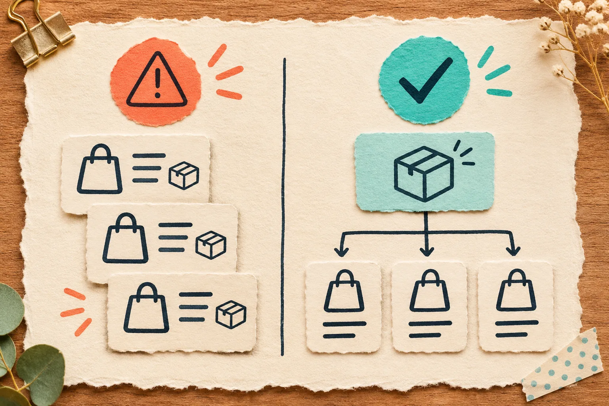

# Catalogue Etsy vers Meta : le contrôle à faire avant chaque synchronisation

Un flux Etsy vers Meta n’est fiable que si les fiches qu’il transporte le sont aussi. Avant chaque synchronisation, contrôlez un petit échantillon de titres, photos, prix, variantes et liens : c’est la manière la plus simple d’éviter qu’un catalogue Meta propage une erreur à vos publications et à votre boutique. [Catalog Generator for Etsy](https://catalog-generator.webyze.com/) fournit une URL de flux pour automatiser l’import ; il ne remplace pas ce contrôle éditorial.

Cette routine est particulièrement utile avant une promotion, une refonte de collection ou l’ajout de nombreuses variations. Elle ne promet pas l’approbation par Meta : l’éligibilité dépend aussi de votre compte, de votre domaine et des règles de commerce en vigueur.

## Pourquoi vérifier avant le rafraîchissement

Importer une fiche une fois à la main masque facilement les écarts. Une source de données, elle, les répète à chaque actualisation. C’est précisément l’intérêt d’un flux : les changements Etsy peuvent revenir dans le catalogue sans ressaisie. Mais la même mécanique peut répercuter un prix oublié, une image trop faible ou une variation incomplète.

Meta expose d’ailleurs des statuts liés aux flux produit dans sa [documentation Catalog](https://developers.facebook.com/docs/graph-api/webhooks/reference/catalog/). Considérez donc le catalogue comme un système à surveiller, pas comme une exportation définitive. Si vous partez de zéro, notre guide sur [la synchronisation des fiches Etsy avec Instagram sans import manuel](https://outils-et-tutoriels.github.io/2026/09/09/comment-synchroniser-vos-fiches-etsy-avec-instagram-sans-import-manuel/) pose le contexte de connexion.

## Le contrôle en six cartes

Prélevez d’abord six fiches Etsy représentatives : une meilleure vente, une nouveauté, une fiche avec variations, une fiche personnalisable, une fiche en promotion et une fiche qui a récemment changé. Ne cherchez pas à tout auditer : cherchez à tester les cas où le flux a le plus de chances de révéler une différence.

| Carte à contrôler | Ce que vous comparez | Signal d’alerte |
| --- | --- | --- |
| Identité | titre, identifiant, URL de destination | lien qui ne mène pas à la bonne fiche |
| Offre | prix, devise, disponibilité | ancien prix ou article indisponible |
| Variation | option, image et prix de chaque déclinaison | une variation absente ou ambiguë |
| Image | visuel principal, cadrage, cohérence avec la fiche | image manquante, trompeuse ou trop faible |
| Livraison | informations présentes dans Etsy | promesse affichée qui ne correspond plus |
| Politique | catégorie et contenu de la fiche | élément sensible à examiner avant diffusion |

L’objectif n’est pas de transformer cette table en règle universelle. Votre catalogue peut comporter d’autres champs importants : matériau, taille, personnalisation, délais. Ajoutez-les lorsque vos clients les utilisent pour choisir. Avant une campagne, reprenez aussi la [checklist de vérification d’un catalogue Etsy avant synchronisation Meta](https://outils-et-tutoriels.github.io/2026/10/04/comment-verifier-votre-catalogue-etsy-avant-une-synchronisation-meta/) : elle complète ce test par les contrôles de contenu.

## Choisir une cadence qui laisse le temps de corriger

Dans Commerce Manager, une URL de flux permet de planifier des récupérations ; Catalog Generator est conçu pour fournir cette URL depuis les annonces Etsy. La bonne fréquence n’est pas forcément la plus courte. Elle doit correspondre à votre rythme de modification et au temps dont vous disposez pour relire les changements.

Voici une règle simple :

- **Peu de changements** : choisissez un rythme régulier et faites le contrôle avant les périodes commerciales importantes.
- **Changements fréquents** : prévoyez un créneau de vérification après les grosses mises à jour, plutôt que de compter uniquement sur la synchronisation.
- **Promotion ou collection saisonnière** : faites une synchronisation test après la modification, puis vérifiez au moins une fiche par type de variation.

Si le catalogue Meta et Etsy ne racontent plus la même histoire, commencez par identifier la dernière modification côté Etsy, vérifiez la disponibilité de l’URL de flux puis consultez l’état du traitement dans Meta. Notre guide pour [diagnostiquer un flux Etsy vers Meta qui ne se met plus à jour](https://outils-et-tutoriels.gitlab.io/guides/2026/11/13/diagnostiquer-un-flux-etsy-vers-meta-qui-ne-se-met-plus-a-jour/) donne un ordre de diagnostic plus détaillé.

## Le test qui évite de corriger au hasard

Après le rafraîchissement, ouvrez dans Meta les six fiches choisies et comparez-les à Etsy, une colonne après l’autre. Notez les écarts dans une liste courte : *champ, fiche, valeur Etsy, valeur Meta, action*. Cette trace est plus utile qu’un souvenir vague de ce que vous avez changé.

Ne modifiez pas cinquante fiches pour faire disparaître un seul écart. Corrigez d’abord une fiche témoin, attendez le prochain traitement, puis vérifiez son résultat. C’est la même prudence que pour [tester une modification Shopify en lot avec un échantillon témoin](https://outils-et-tutoriels.github.io/2026/11/17/tester-une-modification-shopify-en-lot-avec-un-echantillon-temoin/) : une petite boucle de vérification donne une cause plus lisible qu’un grand nettoyage simultané.

## Quand Catalog Generator est le bon choix

Catalog Generator convient si votre besoin principal est de produire une URL de données à partir de vos annonces Etsy, afin que Meta puisse les récupérer sans import de fichier répété. Commencez par le [site de Catalog Generator](https://catalog-generator.webyze.com/), créez le flux, puis documentez votre premier échantillon de contrôle avant d’activer une cadence automatique. Vérifiez au passage les conditions et le tarif affichés au moment de l’inscription : ils peuvent évoluer.

Une synchronisation utile ne se mesure pas au nombre de fiches importées, mais au fait qu’un acheteur arrive sur la bonne annonce, avec la bonne offre. Faites aujourd’hui le test de six cartes ; vous aurez ensuite une routine courte, répétable et beaucoup plus rassurante à chaque mise à jour.
