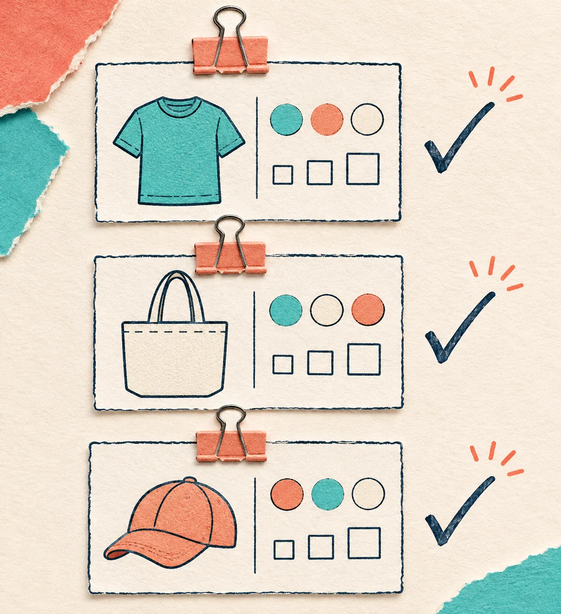

Une modification Shopify en lot se teste mieux sur un échantillon témoin de trois à cinq fiches que sur un export complet. Choisissez volontairement des produits différents, vérifiez la sélection et le champ à modifier, puis comparez le résultat avant d’étendre la tâche. C’est une précaution simple qui rend les erreurs de périmètre visibles quand elles sont encore peu coûteuses.

Quand un catalogue contient plusieurs tailles, couleurs, fournisseurs et collections, une tâche parfaitement raisonnable — normaliser une étiquette, préparer une promotion, compléter un métachamp — peut avoir des effets inattendus. Shopify relie ses produits à des informations qui servent aussi à la recherche, aux collections et à d’autres canaux. La documentation Shopify rappelle d’ailleurs que les types et les tags servent à organiser et filtrer les produits, tandis que SKU et codes-barres ont un rôle distinct de suivi et d’identification.

L’objectif n’est donc pas de ralentir chaque correction. Il est de donner à une mise à jour une petite zone d’essai représentative. Voici la méthode que je garderais dans mes notes avant d’utiliser [Ultimator Bulk Editor](https://apps.shopify.com/ultimate-bulk-editor), l’outil de modification en lot qui permet de cibler produits ou variantes, de définir un changement, puis de l’exécuter tout de suite ou plus tard.

## L’échantillon témoin : petit, varié et expliqué

Un bon échantillon n’est pas un tirage au hasard. Il doit contenir les cas qui risquent de se comporter différemment. Pour une mise à jour de tags, je choisirais par exemple :

- un produit simple avec une seule variante ;
- un produit à plusieurs tailles ou couleurs ;
- une fiche déjà présente dans une collection automatique ou une campagne ;
- si le changement touche un attribut fournisseur ou prix, un cas avec une valeur exceptionnelle.

Notez l’identifiant, la valeur actuelle et la valeur attendue pour chaque fiche. Cette mini-liste devient votre reçu de contrôle. Elle évite le piège du « cela semble bon » après avoir ouvert une seule page.

Cette démarche est complémentaire d’une préparation générale : dans [Comment préparer une mise à jour Shopify en lot sans erreur](https://outils-et-tutoriels.github.io/2026/10/04/comment-preparer-une-mise-a-jour-shopify-en-lot-sans-erreur/), nous avions vu l’intérêt de formuler le changement avant de toucher aux données. Ici, on ajoute une preuve concrète que le ciblage et le résultat correspondent réellement à cette formulation.

## Séparer la règle de sélection du changement

Une tâche en lot contient toujours deux décisions différentes : **quelles fiches entrent dans la tâche** et **quelle valeur change**. Les mélanger rend le diagnostic difficile. Écrivez-les séparément, même si l’outil les présente sur le même écran.

| Élément | Question à noter | Exemple prudent |
| --- | --- | --- |
| Sélection | Qui doit être concerné ? | Produits actifs du fournisseur A avec le tag `hiver` |
| Champ | Quelle donnée change ? | Ajouter le tag `fin-de-serie` |
| Opération | Remplace-t-on ou ajoute-t-on ? | Ajouter, sans supprimer les tags existants |
| Preuve | Où vérifier après ? | Page produit, filtre admin, collection liée |

Cette distinction devient particulièrement importante avec les variantes. Un prix, un SKU ou une option peut vivre au niveau de la variante, alors qu’un type ou une description relève du produit. Si le doute porte sur ce découpage, lisez d’abord [Séparer produits et variantes avant une modification Shopify en masse](https://outils-et-tutoriels.gitlab.io/guides/2026/11/14/separer-produits-et-variantes-avant-une-modification-shopify-en-masse/).

Le sujet n’est pas théorique. Shopify prévient, dans sa documentation CSV, que certaines données de variantes dépendent des colonnes d’options et qu’une modification mal structurée peut créer une variante par défaut ou supprimer des variantes existantes. Une application de modification en lot n’est pas un CSV, mais la leçon reste utile : pour une donnée de variante, contrôlez toujours sur une vraie variante, pas seulement sur le titre du produit parent.

## Exécuter une vraie tâche sur le petit périmètre

Créez maintenant la tâche dans Ultimator Bulk Editor avec les mêmes critères et la même opération que pour le déploiement final, mais limitez-la aux identifiants de l’échantillon. Évitez de tester une version « à peu près identique » : c’est précisément la différence entre le test et la tâche finale qui cache les erreurs.

Avant de lancer, relisez cinq points :

1. Le nombre de résultats correspond-il à votre liste ?
2. L’opération ajoute-t-elle, remplace-t-elle ou supprime-t-elle la valeur attendue ?
3. Le champ est-il bien un champ produit ou variante ?
4. Une collection, un filtre de boutique ou un canal dépend-il de cette donnée ?
5. Le moment d’exécution est-il approprié si vous choisissez de planifier la tâche ?

Pour les prix, ajoutez un contrôle supplémentaire : prix affiché, prix barré éventuel et une variante de chaque type. Le guide [Comment modifier des prix Shopify en masse sans créer d’effet domino](https://outils-et-tutoriels.github.io/2026/10/28/comment-modifier-des-prix-shopify-en-masse-sans-creer-d-effet-domino/) détaille pourquoi un tarif cohérent sur une fiche ne garantit pas encore la cohérence sur tout le catalogue.

## Lire le résultat comme un reçu, pas comme une impression

Après l’exécution, ouvrez chaque fiche témoin et comparez-la à votre note initiale. Cherchez à la fois le changement attendu et les effets voisins : une collection qui n’affiche plus le produit, une variante qui porte une valeur différente, ou un filtre qui ne retourne plus les mêmes résultats. Pour les tags et les types, un coup d’œil aux filtres administrateur est souvent plus parlant qu’une seule page produit.

| Observation sur l’échantillon | Décision raisonnable |
| --- | --- |
| Les trois à cinq fiches sont justes, sans effet voisin | Étendre la même tâche au périmètre complet |
| Une valeur est juste mais une collection réagit mal | Corriger la règle, puis retester le même échantillon |
| Une variante diffère du produit parent | Arrêter et vérifier le niveau du champ |
| Le nombre de résultats ne correspond pas | Revoir le filtre avant toute extension |

Ce dernier contrôle est une suite naturelle de [Standardiser les types de produits Shopify sans brouiller votre catalogue](https://outils-et-tutoriels.github.io/2026/11/01/standardiser-les-types-de-produits-shopify-sans-brouiller-votre-catalo/). La valeur elle-même peut être correcte, tout en modifiant la façon dont vos outils et collections interprètent le catalogue.

## Étendre seulement quand le test répond à la question

Une fois l’échantillon validé, vous n’avez pas besoin de refaire le travail à la main. Reprenez exactement la règle documentée et élargissez le périmètre dans Ultimator Bulk Editor, ou planifiez la tâche pour une fenêtre calme. L’application indique prendre en charge les recherches et filtres, les tâches planifiées et la modification en lot de produits, variantes, prix, tags, inventaire, SEO et métachamps ; cela la rend pratique pour exécuter une opération répétable, mais ne remplace pas votre règle de contrôle.

La prochaine fois qu’une correction touche plus de quelques fiches, commencez par écrire votre échantillon témoin avant d’ouvrir l’outil. Trois produits bien choisis ne prouvent pas que tout le catalogue est parfait ; ils répondent à la meilleure première question : « la sélection et le changement font-ils bien ce que j’ai demandé ? » Si oui, vous pouvez élargir avec beaucoup plus de sérénité.
