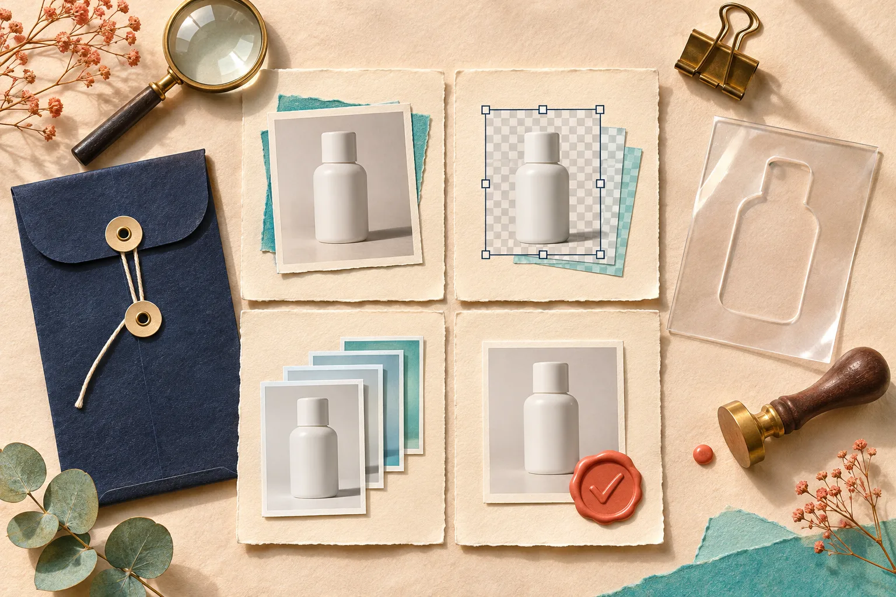
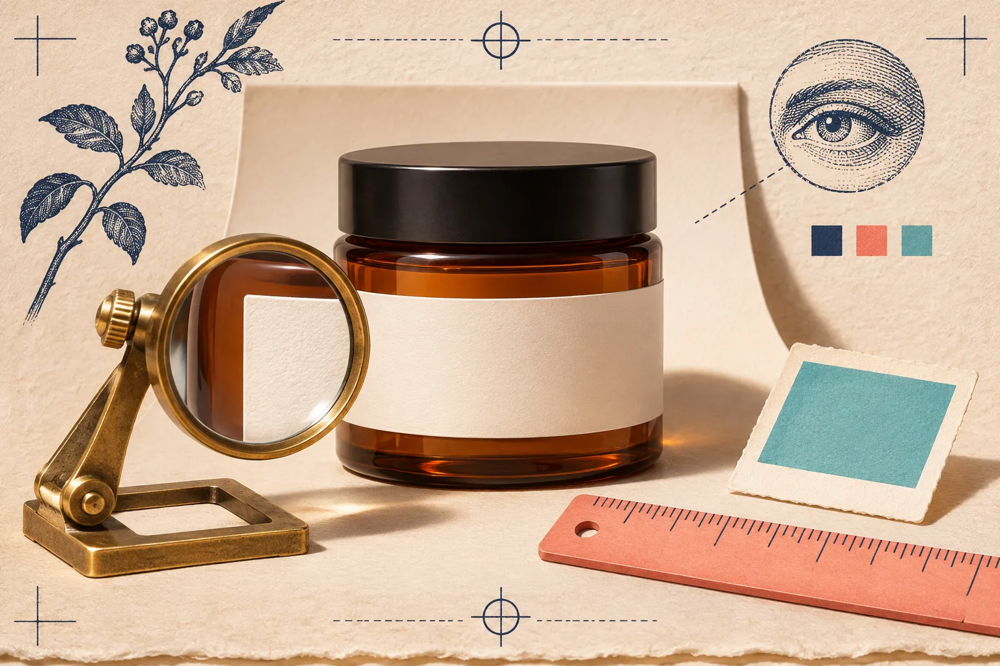
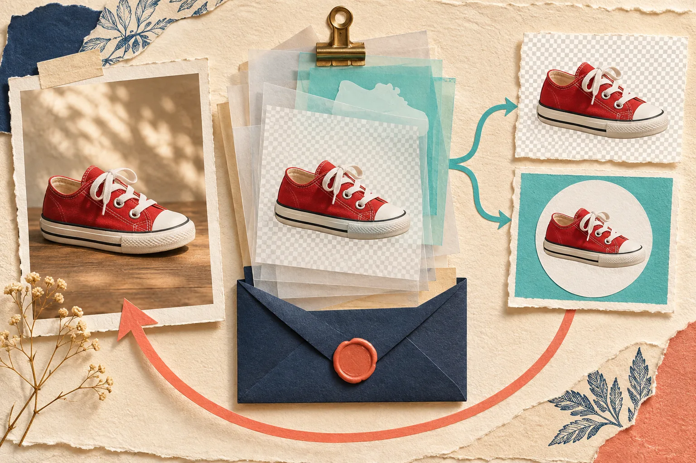

Une photo produit retouchée se livre mieux avec quatre éléments : la source, un master éditable, les exports nommés pour leur usage et une courte preuve de contrôle. Ce paquet rend les corrections réversibles et évite qu’un visuel destiné à une bannière devienne, par erreur, la nouvelle référence produit.

[ImageFlow](https://imageflow.dev/) est utile ici parce qu’il réunit dans le navigateur les calques, masques, calques de réglage, objets dynamiques et l’import/export PSD. Le but n’est pas de promettre une retouche parfaite en un clic : c’est de pouvoir expliquer ce qui a changé, vérifier le résultat et revenir au fichier de travail quand une équipe demande une variante.



## Le problème : un JPEG final ne raconte pas la décision

Un export propre peut suffire pour publier, mais il ne dit ni quel fichier a servi de point de départ, ni si un détouré, une correction colorimétrique ou une suppression d’objet peut être ajustée. C’est précisément ce qui transforme une petite demande — « peux-tu remplacer le fond ? » — en reprise incertaine quelques semaines plus tard.

Le bon niveau de livraison dépend du contexte : une campagne ponctuelle peut n’exiger qu’un export validé ; une fiche produit, un catalogue ou un client qui doit décliner le visuel mérite un paquet plus complet. Ne confondez pas, surtout, fichier de travail et image prête à diffuser. Le premier protège la possibilité de corriger ; la seconde est optimisée pour un canal donné.

## La règle des quatre fichiers

Voici le paquet que je recommande pour une retouche qui devra peut-être vivre plus d’une semaine.

| Élément | Rôle | À ne pas faire |
| --- | --- | --- |
| Source | Conserver la prise de vue reçue ou sélectionnée | Écraser l’original avec la retouche |
| Master | Garder calques, masques et réglages modifiables | Aplatir avant la validation |
| Export | Livrer un fichier pour la fiche, la pub ou la newsletter | Réutiliser un même format partout |
| Preuve | Noter les changements et les contrôles effectués | Se limiter à « c’est bon » |

Dans ImageFlow, ouvrez la source puis faites les changements sur des calques et avec des masques quand c’est possible. Les calques de réglage et les objets dynamiques sont pertinents lorsque vous devrez revoir l’exposition, le recadrage ou une composition. Pour un document complexe, faites tout de même un aller-retour d’essai avant de promettre une compatibilité parfaite à votre équipe.



## Construire la preuve de contrôle en cinq minutes

La preuve n’est pas un rapport lourd. Une note jointe au dossier suffit, à condition qu’elle réponde aux bonnes questions :

1. **Source et date** : quel fichier a été utilisé ?
2. **Changements** : fond retiré, poussière supprimée, lumière ajustée, recadrage ou texte modifié.
3. **Invariants produit** : couleur, matière, taille apparente, logo, accessoires et étiquette n’ont pas été altérés.
4. **Exports** : quels fichiers correspondent à Shopify, une publicité ou un envoi client ?
5. **Point de reprise** : quel master ouvrir si une correction est demandée ?

Cette dernière ligne évite la chasse au bon fichier. Elle complète bien le [contrôle avant publication d’une photo produit](https://outils-et-tutoriels.github.io/2026/10/13/comment-preparer-une-photo-produit-shopify-sans-installer-photoshop/) : le contrôle garantit que l’image est juste aujourd’hui ; le paquet de livraison garantit qu’elle reste corrigeable demain.

## Le contrôle qui protège la vérité du produit

Avant d’exporter, regardez le visuel à 100 % et à la taille à laquelle il sera réellement affiché. Zoomez sur le bord du masque, les lettres d’une étiquette, les zones transparentes, les reflets et les ombres de contact. Une sélection automatique ou un remplissage peut être un excellent point de départ, mais les cheveux, le verre, les matières brillantes et les détails fins demandent une vérification humaine.

Gardez un critère simple : la retouche peut améliorer la lisibilité, pas réinventer l’objet. Retirer une poussière ou isoler un produit est différent de modifier sa couleur, de masquer un défaut déterminant ou de faire croire qu’un accessoire est inclus. Pour les cas où un élément du décor gêne vraiment, suivez aussi ce guide pour [retirer un objet parasite sans tromper vos clients](https://outils-et-tutoriels.github.io/2026/11/12/retirer-un-objet-parasite-d-une-photo-produit-sans-tromper-vos-clients/).



## Nommer les exports selon leur destination

Un nom explicite réduit les erreurs plus sûrement qu’un dossier appelé « final-final ». Par exemple :

```text\nlampe-vert-sauge_source_2026-11-18.jpg\nlampe-vert-sauge_master-v03.psd\nlampe-vert-sauge_shopify-2048.jpg\nlampe-vert-sauge_meta-carre-1080.jpg\nlampe-vert-sauge_controle-v03.txt\n```

Le suffixe décrit la destination, pas un jugement vague. Vous saurez ainsi si l’export doit être recadré, compressé ou décliné, sans toucher au master. Cette séparation prolonge la logique de [remise d’une photo retouchable à un client](https://outils-et-tutoriels.github.io/2026/11/03/comment-remettre-une-photo-produit-retouchable-a-un-client/) : le client reçoit ce dont il a besoin, mais la structure de reprise reste claire.

## Quand un export seul est suffisant

Ne fabriquez pas un dossier sophistiqué pour chaque miniature. Un export unique est raisonnable si la demande est ponctuelle, que l’image ne sera pas redéclinée et que la personne qui l’utilise n’a pas besoin de modifier la retouche. En revanche, ajoutez master et note de contrôle dès qu’il y a plusieurs canaux, une validation client, une équipe marketing ou une photographie coûteuse à reproduire.

Avant de livrer, ouvrez le PSD de travail et un export dans leur destination prévue : ce contrôle simple révèle un texte manquant, un masque aplati ou un recadrage involontaire avant que l’image parte chez le client.

## La prochaine action la plus utile

Ouvrez une vraie photo dans ImageFlow et faites seulement la plus petite correction nécessaire. Gardez la source, enregistrez un master avec ses calques, exportez une version pour un seul canal, puis ajoutez cinq lignes de preuve. Ce rituel prend peu de temps et vous évite de devoir deviner, plus tard, ce qui a été changé — ou de refaire une retouche que vous aviez déjà rendue réversible.

En résumé : une image finale publie une décision ; un paquet de livraison permet de l’examiner et de la corriger. Pour une activité en ligne, c’est une différence très concrète.
