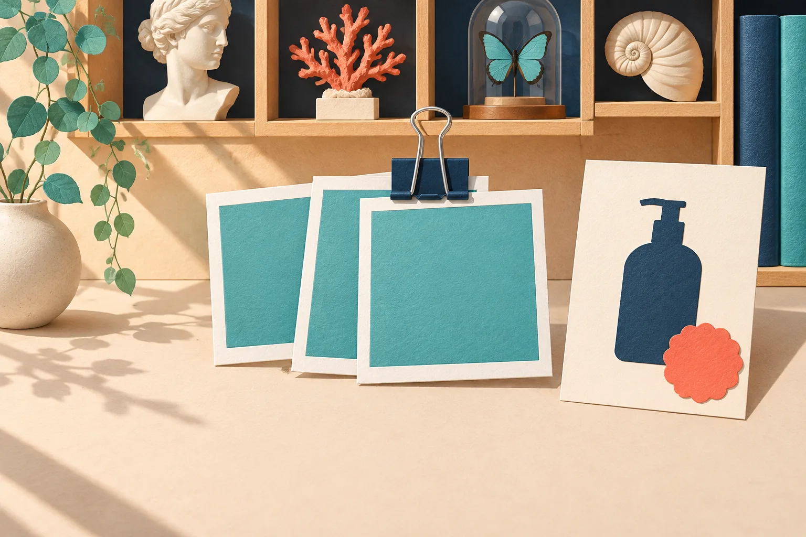

# Comment exporter une photo produit Shopify sans perdre l’original

Quand une photo est enfin propre, la tentation est de l’écraser par un export JPG puis de passer à autre chose. C’est précisément ce qui rend la prochaine demande — un carré pour la collection, un recadrage pour une publicité, une correction de teinte — inutilement coûteuse. La solution est simple : gardez un master intact, travaillez dans un fichier éditable, puis créez des exports nommés pour chaque usage.

C’est une habitude très accessible avec [ImageFlow](https://imageflow.dev/), un éditeur d’images dans le navigateur qui propose calques, masques, calques de réglage, objets dynamiques et import/export PSD. Il ne remplace pas chaque fonction d’un logiciel de bureau, mais il suffit largement pour construire un petit circuit de retouche réversible.

## Le système à quatre fichiers qui évite les retouches irréversibles

Ne cherchez pas un nom parfait : cherchez une séparation nette entre ce qui est source, ce qui est modifiable et ce qui est livré. Pour une référence produit, je recommande ces quatre éléments :

| Fichier | Rôle | Peut-on le modifier ? |
| --- | --- | --- |
| `SKU-01_master` | la photo reçue ou prise de vue | non |
| `SKU-01_editable.psd` | calques, masques et réglages | oui |
| `SKU-01_shopify-carré.jpg` | export pour la fiche ou la collection | non, on régénère |
| `SKU-01_note.txt` | décision de recadrage, fond, date | oui |

Le master ne sert pas à « travailler proprement » par principe : il sert à pouvoir répondre quand quelqu’un demande pourquoi une couture, une ombre ou une couleur a changé. Le fichier éditable devient votre point de reprise. L’export, lui, est jetable. Cette distinction prolonge la logique détaillée dans notre guide pour [remettre une photo produit retouchable à un client](https://outils-et-tutoriels.github.io/2026/11/03/comment-remettre-une-photo-produit-retouchable-a-un-client/).

## 1. Décidez ce que l’image doit prouver

Avant de détourer ou de recadrer, notez l’usage exact : image principale, vignette de collection, détail matière ou visuel de campagne. Une fiche produit doit d’abord montrer le bon objet, dans sa bonne couleur et avec les accessoires réellement inclus. Une belle composition qui fait disparaître un élément déterminant est un mauvais export.

Pour Shopify, les images produit et de collection peuvent aller jusqu’à 5 000 × 5 000 px ou 25 mégapixels, avec un fichier inférieur à 20 Mo ; Shopify recommande notamment 2 048 × 2 048 px pour des images carrées et rappelle qu’un ratio cohérent aide l’affichage en collection ([documentation Shopify](https://help.shopify.com/en/manual/products/product-media/product-media-types)). Ce sont des limites et des repères, pas une obligation de transformer chaque photo en carré.

## 2. Retouchez par calques, pas par effacement

Ouvrez une copie dans ImageFlow et enregistrez tôt votre document éditable. Une correction d’exposition ou de contraste mérite un calque de réglage ; un détourage mérite un masque. Ainsi, un bord trop agressif peut être repris sans recommencer l’image.

Pour un fond à nettoyer, procédez par petites décisions : sélection du sujet, masque, zoom sur les contours, puis nouveau fond si le contexte le demande. Les cheveux, mailles, transparences, réflexions et bords de verre sont justement les zones où l’automatisation doit être relue. Si un objet parasite est réellement hors produit, notre guide explique [comment le retirer sans tromper vos clients](https://outils-et-tutoriels.github.io/2026/11/12/retirer-un-objet-parasite-d-une-photo-produit-sans-tromper-vos-clients/). Ne retirez jamais un défaut, une pièce ou un détail qui changerait ce que l’acheteur reçoit.

## 3. Créez un export pour une question précise

À partir du même fichier éditable, créez une version par destination. Voici une règle de décision utile :

- **Grille de collection** : même ratio que les autres visuels, sujet lisible à petite taille.
- **Fiche produit** : cadre plus généreux, détails visibles, aucun recadrage qui cache une caractéristique importante.
- **Campagne** : fond et composition plus expressifs, à condition que le produit reste fidèle.
- **Marketplace** : vérifiez d’abord les exigences de la plateforme ; n’imposez pas un fond ou un ratio supposé.

Cette discipline est le pendant visuel de la méthode qui consiste à [tester une modification Shopify en lot avec un échantillon témoin](https://outils-et-tutoriels.github.io/2026/11/17/tester-une-modification-shopify-en-lot-avec-un-echantillon-temoin/) : avant de généraliser, validez une image sur la vraie surface où elle sera vue.

## 4. Faites une vérification en trois vues

Avant l’export final, regardez la photo de trois manières : à 100 %, dans la taille d’une vignette, puis à côté de deux autres produits de la collection. Cette dernière vue révèle très vite un ratio incohérent ou une luminosité qui rompt la série.

Utilisez cette mini-checklist :

1. Les contours, étiquettes et logos correspondent-ils au produit réel ?
2. La couleur est-elle crédible dans le contexte de la gamme, sans correction excessive ?
3. Le produit reste-t-il identifiable dans le recadrage de collection ?
4. Le nom du fichier indique-t-il clairement son usage plutôt qu’un vague `final-v2` ?
5. Le PSD ou document éditable est-il conservé avant de remplacer un média publié ?

La cohérence ne signifie pas que tout doit se ressembler mécaniquement. Elle signifie que l’acheteur peut comparer sans deviner. C’est aussi pourquoi il vaut la peine de [préparer une photo détourée pour plusieurs fonds](https://outils-et-tutoriels.gitlab.io/guides/2026/11/05/comment-preparer-une-photo-produit-detouree-pour-plusieurs-fonds/) à partir d’une même découpe contrôlée, au lieu de refaire l’objet à chaque campagne.

## Quand faut-il repartir de la prise de vue ?

Un bon export ne répare pas tout. Reprenez une photo si la mise au point manque, si la lumière masque une matière importante, si le produit est déformé par l’objectif ou si la couleur reste incertaine après une correction raisonnable. Les réglages et le relighting peuvent améliorer la lisibilité ; ils ne doivent pas inventer une texture, une dimension ou un rendu absent de la prise de vue.

Pour les variations de fond ou de traitement, gardez la même question de contrôle : « Cette version aide-t-elle à voir le même produit, ou en crée-t-elle un autre ? » Notre article sur [les images IA à garder sur une fiche produit Shopify](https://outils-et-tutoriels.github.io/2026/11/10/quelles-images-ia-garder-sur-une-fiche-produit-shopify/) propose le même réflexe de fidélité.

## Une prochaine action très concrète

Prenez une image déjà publiée et créez seulement son duo : un master inchangé et un fichier éditable avec un export clairement nommé. Ouvrez-le ensuite dans [ImageFlow](https://imageflow.dev/) et faites la plus petite correction utile avec un masque ou un calque de réglage. Si vous pouvez retrouver l’original, expliquer le choix et régénérer l’export en cinq minutes, votre flux d’images est déjà plus solide.

Une photo produit n’est pas « terminée » parce qu’un JPG existe. Elle est prête quand l’export répond à son usage, que le produit reste vrai et que vous pouvez revenir en arrière sans paniquer.
