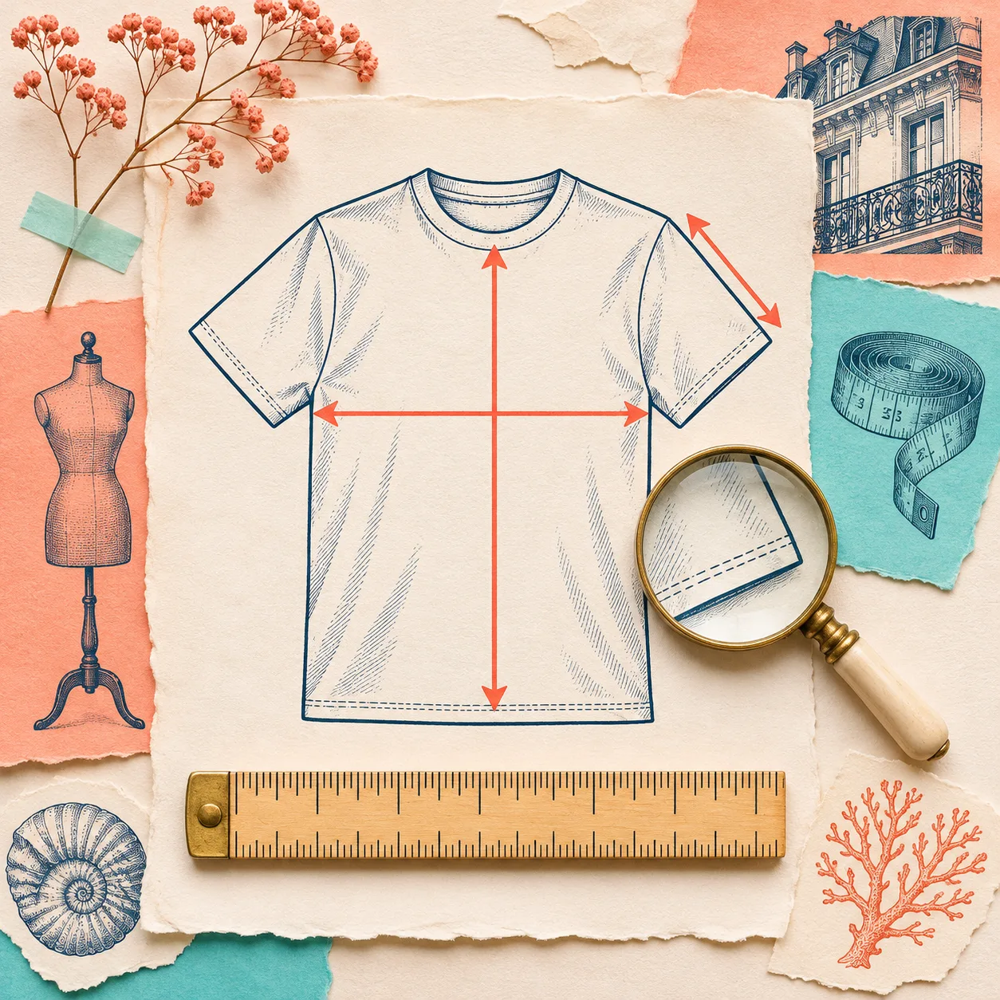

# Rendre un guide de tailles Shopify lisible pour davantage de clients

Un guide de tailles utile ne consiste pas seulement à ajouter un tableau sous la description. Il doit permettre à une personne de repérer la bonne mesure, de savoir où placer son mètre ruban et de comparer sans deviner. Pour y arriver, gardez peu de colonnes, expliquez le type de mesure, employez un contraste net et vérifiez le parcours au clavier comme sur mobile. C’est exactement le type de guide qu’un outil comme [Supra Size Chart](https://supra-size-chart.sktch.io/) aide à centraliser dans Shopify, plutôt que de recopier du HTML produit par produit.

L’accessibilité ici est très concrète : si une information de taille n’est lisible qu’en zoomant, qu’au survol ou dans une image, elle ne répond pas à la question d’achat. La bonne nouvelle est qu’une petite grille de contrôle améliore aussi la clarté pour tout le monde.

## Commencer par la décision que le client doit prendre

Avant de dessiner le tableau, formulez la question de la fiche produit : « Quelle taille dois-je choisir pour ce vêtement précis ? » Cela évite les tableaux encyclopédiques où l’essentiel se perd.

Pour un t-shirt, une première version suffit souvent : taille, tour de poitrine du vêtement, longueur et coupe. Si la mesure concerne le corps plutôt que le vêtement posé à plat, dites-le dans l’intitulé. Ne mélangez pas les deux sans explication : une poitrine de vêtement et un tour de poitrine du corps ne répondent pas à la même question.

Voici un filtre rapide pour chaque colonne :

| Conserver | Reformuler | Retirer ou déplacer |
| --- | --- | --- |
| Une mesure qui aide à choisir une taille | Une abréviation ou un nom ambigu | Une donnée technique sans effet sur le choix |
| L’unité associée à la mesure | « Poitrine » en « tour de poitrine du vêtement » | Un doublon en note de bas de page |
| Une note de coupe si elle change la décision | « Taille normale » avec un exemple concret | Une promesse vague sur l’ajustement |

La précision ne signifie pas tout afficher. Pour une veste, les épaules peuvent être décisives ; pour un pantalon, ce sera plutôt la taille, l’entrejambe et l’ouverture de jambe. Les accessoires, eux, gagnent souvent à indiquer une plage d’ajustement plutôt qu’une succession de tailles vestimentaires.

## Donner une instruction de mesure qui ne repose pas sur la devinette

Un tableau clair échoue si le client ne sait pas où mesurer. Ajoutez une courte consigne près de la mesure concernée, puis un guide visuel si l’article est sensible à l’ajustement. Deux ou trois repères bien nommés valent mieux qu’une silhouette chargée.

La documentation Shopify décrit les [metaobjects](https://shopify.dev/docs/apps/build/metaobjects) comme des données structurées réutilisables ; elle cite justement les guides de tailles parmi les exemples. C’est une bonne base mentale : traitez les mesures, les consignes et le guide visuel comme un contenu réutilisable, pas comme un bloc de texte collé dans chaque description.

Avec Supra Size Chart, un même guide de mesure peut accompagner plusieurs tableaux, tandis que les règles d’affectation associent le contenu aux produits qui le demandent. Si votre catalogue est vaste, cette séparation réduit le risque d’avoir une ancienne instruction sur une nouvelle fiche. Elle va dans le même sens que ce [contrôle des changements Shopify en lot](https://outils-et-tutoriels.github.io/2026/11/17/tester-une-modification-shopify-en-lot-avec-un-echantillon-temoin/) : on modifie une source, puis on vérifie des cas représentatifs.

## Faire en sorte que le tableau survive au mobile, au zoom et au clavier

Un guide de tailles n’a pas besoin d’un habillage spectaculaire. Il a besoin d’une lecture stable. Utilisez des en-têtes explicites, un contraste suffisant entre texte et fond, des lignes assez espacées et des unités répétées dans l’en-tête plutôt que cachées dans une légende distante. Ne communiquez jamais une différence uniquement par couleur.

Testez ensuite ces quatre situations :

1. **Mobile étroit** : les en-têtes et les valeurs restent-ils associés sans défilement incompréhensible ?
2. **Zoom important** : les notes de coupe et les unités sont-elles encore faciles à trouver ?
3. **Navigation au clavier** : le déclencheur du guide et son contenu restent-ils atteignables dans un ordre logique ?
4. **Mode sombre ou thème contrasté** : les libellés conservent-ils leur lisibilité ?

Le choix de l’affichage compte aussi. Un tableau intégré convient quand la taille est centrale dans la décision ; un accordéon limite l’encombrement pour une fiche déjà dense ; une fenêtre modale peut convenir si son bouton est clair et si elle se referme proprement. Shopify précise que les app blocks doivent être ajoutés dans une section de thème compatible et que, par défaut, ils ne sont pas automatiquement présents après l’installation. Consultez donc la [documentation des blocs d’application](https://shopify.dev/docs/apps/build/online-store/theme-app-extensions/configuration) avant de conclure qu’un problème de lisibilité vient du contenu seul.

Cette vérification ressemble à celle d’une [préparation d’images produit avant mise en ligne](https://outils-et-tutoriels.gitlab.io/guides/2026/11/21/checklist-preparer-des-images-produit-pour-shopify-sans-les-alourdir-i/) : le contenu peut être juste, mais sa présentation sur la vraie fiche produit décide de son utilité.

## Créer un petit jeu de test, pas une démonstration parfaite

Choisissez trois produits : un article à coupe standard, un article à coupe particulière et un produit qui doit utiliser le guide par défaut. Ouvrez-les dans le thème publié et vérifiez :

- le bon tableau apparaît ;
- la mesure importante est comprise sans ouvrir une autre page ;
- le guide visuel correspond bien au vêtement ;
- l’unité choisie est visible ;
- le comportement reste correct avec le zoom du navigateur et le clavier.

Notez le résultat dans une fiche courte : produit, règle attendue, tableau attendu, mode d’affichage, anomalie éventuelle. Cela transforme « le guide semble bon » en test reproductible. Pour les catalogues qui s’appuient déjà sur des règles, ce réflexe complète bien un [audit de règles avant lancement](https://tools-and-how-tos.github.io/2026/10/30/how-to-audit-shopify-size-chart-rules-before-a-catalog-launch/).

## Une hiérarchie de contenu qui évite la surcharge

Quand le guide devient long, séparez ce qui aide à décider maintenant de ce qui rassure ensuite :

- en premier, le tableau et l’indication de la coupe ;
- juste après, la façon de prendre la mesure ;
- puis les détails régionaux, la conversion et les notes d’entretien si elles influencent l’ajustement.

Cette hiérarchie est particulièrement utile lorsqu’une collection rassemble des coupes voisines mais non identiques. N’essayez pas de résoudre une différence de patronage avec une note minuscule. Créez un tableau distinct ou une règle plus précise. Vous préserverez la confiance plus sûrement qu’en promettant qu’« une taille convient à tous ».

## Mettre en place une maintenance légère

Une fois le guide lisible, gardez une source unique et une sortie possible. Supra Size Chart propose un éditeur de tableau, des règles par produit, collection, type, fournisseur ou étiquette, ainsi que l’import et l’export CSV ou JSON. Le service est annoncé comme gratuit sur sa [fiche Shopify App Store](https://apps.shopify.com/supra-size-chart). Cela en fait une option cohérente si vous devez corriger régulièrement les mesures sans reprendre chaque description de produit.

Mon conseil : planifiez une revue à chaque nouvelle coupe, changement de fournisseur ou refonte de fiche produit. Vérifiez trois produits, pas seulement le tableau dans l’administration. Et si vous préparez une campagne, ajoutez ce point à votre liste de validation plutôt que de découvrir après publication qu’un guide essentiel est invisible.

Un guide de tailles accessible est moins une question de design qu’un contrat de clarté : une mesure identifiable, une instruction compréhensible et un affichage que le client peut réellement utiliser. Commencez par un produit important, appliquez le test des trois fiches, puis étendez la même structure au reste du catalogue.
