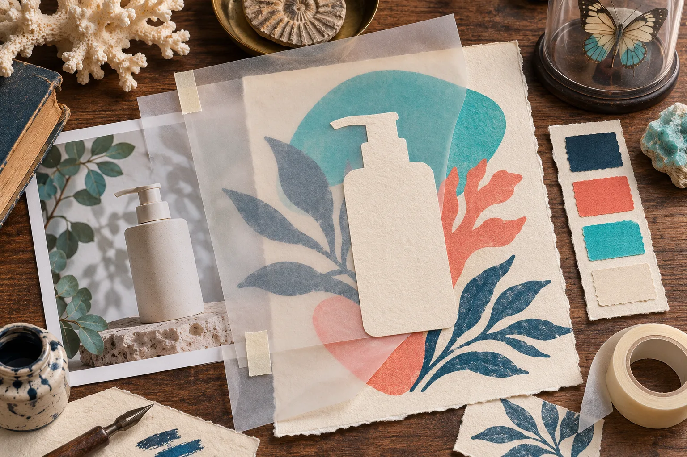
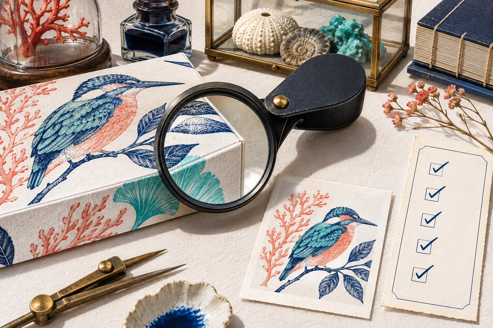
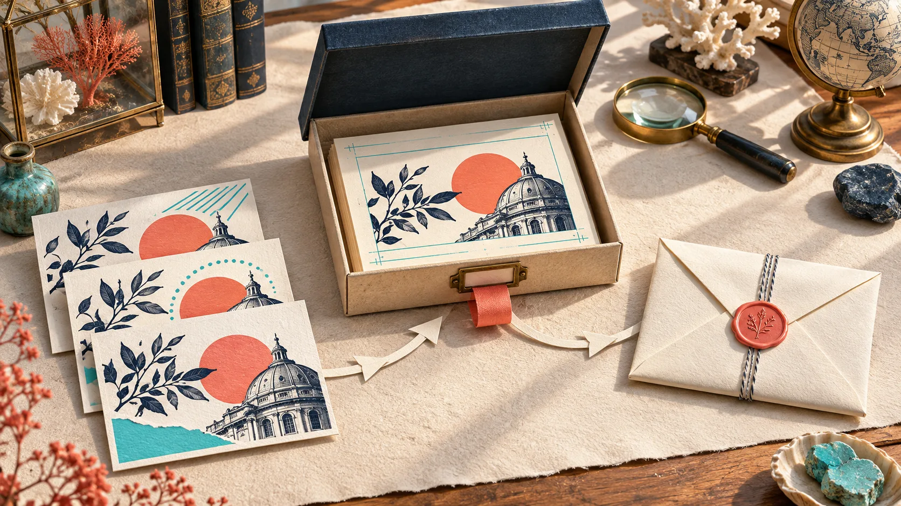

# Créer trois variantes de visuel depuis un PSD sans perdre le master

Décliner un visuel de campagne à partir d’un PSD ne demande pas de refaire trois fichiers ni d’aplatir le premier par réflexe. La méthode la plus sûre consiste à protéger le master, isoler les éléments qui changent et exporter des copies contrôlées. Avec [ImageFlow](https://imageflow.dev/), on peut ouvrir un PSD, travailler avec calques, masques, objets dynamiques et réglages, puis exporter ses variantes directement dans le navigateur.

C’est particulièrement utile quand une même image doit devenir une bannière de collection, une carte pour les réseaux et un visuel d’e-mail. L’objectif n’est pas de produire plus d’images : c’est de garder une source éditable et une promesse produit exacte à chaque format.

## Le principe : un master, des décisions nommées

Avant toute duplication, ouvrez le PSD et faites une petite lecture de structure. Repérez la photo source, le détourage, le fond, les textes et les effets. ImageFlow annonce la prise en charge des calques, groupes, masques, calques de réglage, objets dynamiques ainsi que l’import et l’export PSD : ce sont précisément les briques qui rendent une déclinaison réversible plutôt qu’improvisée.

Ne modifiez pas le fichier maître au hasard. Enregistrez une copie de travail par usage, avec un nom explicite : `campagne-hiver_master.psd`, puis `campagne-hiver_email.psd`, `campagne-hiver_social.psd` et `campagne-hiver_banniere.psd`. Ce petit contrat de nommage évite de livrer une image correcte mais impossible à reprendre. Notre [fiche de livraison d’une photo produit retouchée](https://outils-et-tutoriels.github.io/2026/11/18/photo-produit-retouchee-le-paquet-de-livraison-qui-evite-les-malentend/) complète bien cette étape si le fichier doit passer à une autre personne.

## 1. Verrouillez ce qui ne doit jamais changer

La photo du produit, son logo, ses couleurs, sa forme et les accessoires réellement inclus ne sont pas des variables créatives. Gardez-les dans un groupe nommé `SOURCE — ne pas modifier`, ou protégez-les dans votre convention de calques. Si vous créez une silhouette ou un détourage, utilisez un masque plutôt qu’une gomme : vous pourrez corriger un bord sans reconstruire l’image.

C’est la différence importante entre adapter une mise en page et réinventer le produit. Un changement de fond peut être légitime ; faire disparaître un détail de fabrication ne l’est pas. Pour une révision avant mise en ligne, gardez aussi sous la main notre méthode pour [exporter une photo Shopify sans perdre l’original](https://outils-et-tutoriels.github.io/2026/11/23/comment-exporter-une-photo-produit-shopify-sans-perdre-l-original/).

## 2. Créez une variante en ne touchant qu’aux calques variables

Dupliquez le document, puis limitez-vous à trois familles de calques :

- le **format** : dimensions et zone de sécurité ;
- le **message** : titre, accroche, prix ou appel à l’action ;
- le **contexte** : fond, aplat, élément décoratif ou cadrage.

Tout le reste reste identique. Pour un visuel vertical, vous pouvez recadrer la zone autour du produit et déplacer le bloc de texte. Pour une bannière, élargissez plutôt le fond et conservez plus d’espace négatif. Si un réglage de luminosité sert aux trois versions, gardez-le dans un calque de réglage commun ; s’il répond à une contrainte de canal, nommez-le `REGLAGE — social uniquement`.

Cette discipline est moins spectaculaire qu’un clic d’IA, mais elle rend la décision vérifiable. Lorsque vous avez besoin de retirer un objet du décor, documentez pourquoi il n’apporte rien : [retirer un objet parasite sans tromper ses clients](https://outils-et-tutoriels.github.io/2026/11/12/retirer-un-objet-parasite-d-une-photo-produit-sans-tromper-vos-clients/) reste une bonne frontière éditoriale.

## 3. Utilisez une carte de décision avant l’export

Voici la carte que je garderais à côté du fichier :

| Question | Si la réponse est oui | Si la réponse est non |
| --- | --- | --- |
| Le produit est-il identique au master ? | Continuer | Revenir aux calques source ou au masque |
| Le texte est-il lisible au format réel ? | Continuer | Ajuster la hiérarchie, pas seulement la taille |
| Le recadrage coupe-t-il un détail utile ? | Continuer | Prévoir un autre format ou un autre cadrage |
| La variante reste-t-elle éditable ? | Exporter une copie | Sauvegarder d’abord le PSD de travail |

Le contrôle se fait à 100 % de zoom, mais aussi à la taille à laquelle le client verra l’image. Vérifiez les bords du détourage, les petites lettres, les reflets, les étiquettes et les ombres. Un fond propre ne compense jamais une information produit devenue ambiguë.

## 4. Exportez trois fichiers, pas trois versions de la vérité

À ce stade, exportez le JPG ou PNG requis pour chaque canal, sans remplacer le PSD de travail. Ajoutez le format et la date au nom de l’export : `campagne-hiver_social_1080x1350.png`, par exemple. Gardez aussi le lien entre l’export et sa source ; c’est ce qui permet de mettre à jour une promotion ou une mention légale sans repartir de zéro.

ImageFlow est intéressant ici parce qu’il place ce travail dans un éditeur de navigateur avec une logique de document, pas dans un résultat à usage unique. Cela ne signifie pas que tout PSD complexe donnera un aller-retour parfait : testez d’abord un fichier représentatif si vos documents utilisent des fonctions avancées. Pour des retouches localisées, les outils de sélection et de remplissage peuvent accélérer le travail, mais inspectez toujours les contours, les logos et les détails fins avant livraison.

## 5. Livrez le couple utile : exports et fichier retouchable

La bonne livraison comprend les exports prêts à publier, le PSD ou fichier de travail éditable, et une note très courte qui dit ce qui varie d’un format à l’autre. Cela évite que le prochain intervenant reprenne un PNG aplati en pensant qu’il s’agit du master.

Si vous cherchez une façon simple de travailler, [ouvrez ImageFlow](https://imageflow.dev/) avec un seul PSD réel et faites d’abord la plus petite variante utile. Créez ensuite vos deux autres formats en gardant exactement la même photo source. Vous aurez une campagne cohérente, des exports propres et surtout un master qui reste vivant.

En résumé : séparez ce qui est vrai du produit de ce qui sert la mise en page, faites varier seulement le nécessaire, puis contrôlez chaque export à sa taille réelle. C’est une routine courte qui évite les retouches irréversibles et les futures reconstructions inutiles.
