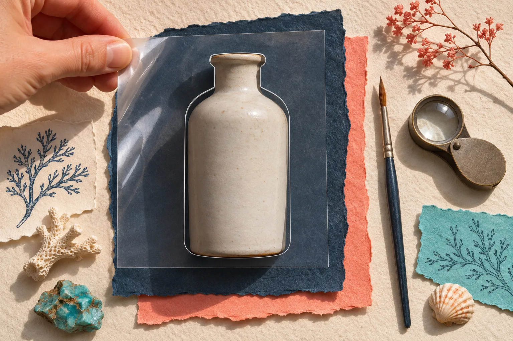
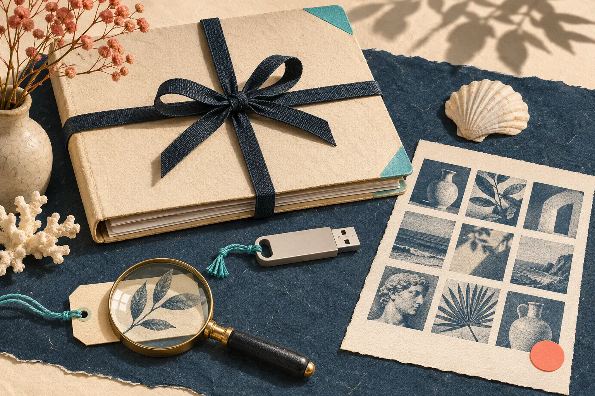

# Comment préparer un PSD pour l’impression sans casser sa version web

Préparer un PSD pour l’impression ne consiste pas à convertir aveuglément le fichier final : il faut d’abord préserver le master, vérifier ce qui change selon la destination et créer des exports séparés. Avec un éditeur à calques comme [ImageFlow](https://imageflow.dev/), on peut ouvrir le document dans le navigateur, contrôler les éléments fragiles puis livrer un PDF ou une image web sans écraser la version de travail.

C’est particulièrement utile lorsqu’une même photo produit doit nourrir une fiche Shopify, un flyer et une brochure. Le piège est de faire une correction locale — un fond, un recadrage, une typographie — puis de la laisser contaminer toutes les sorties. Voici une méthode courte pour garder des fichiers cohérents et honnêtes.

## La règle de départ : un master, des sorties distinctes

Le fichier master est votre document éditable : calques nommés, masque, réglages et éléments source y restent disponibles. Une sortie est une copie fabriquée pour un usage précis. Ne convertissez pas le master en fichier « prêt à imprimer » et ne remplacez pas son export web par un PDF.

Dans ImageFlow, les calques, groupes, masques, calques de réglage et objets dynamiques servent justement à conserver cette marge de manœuvre. Le service annonce également l’import et l’export PSD/PSB ; sur un document de production complexe, faites toutefois un aller-retour sur votre propre fichier avant d’en faire une règle d’équipe.

Cette séparation résout un problème plus concret qu’il n’y paraît : une image web optimisée peut être trop petite pour l’impression, tandis qu’un visuel mis en page pour un dépliant peut être mal recadré sur une fiche produit. Gardez le même produit, mais acceptez que le cadre, la résolution et le format de livraison changent.

## Les quatre contrôles avant de créer une version impression

1. **Vérifiez la source à taille réelle.** Ouvrez le PSD et regardez l’image à 100 %, surtout autour des étiquettes, bords, textures, transparences et ombres. Un détouré qui paraît propre dans une vignette peut révéler un halo sur papier. Cette vérification complète bien la méthode déjà présentée pour [retirer un objet parasite sans tromper vos clients](https://outils-et-tutoriels.github.io/2026/11/12/retirer-un-objet-parasite-d-une-photo-produit-sans-tromper-vos-clients/).

2. **Gardez les corrections réversibles.** Préférez un masque à l’effacement, et un calque de réglage à une modification directe des pixels. ImageFlow propose les masques et réglages non destructifs nécessaires à ce type de travail. Si le fond ou la lumière doit être repris, la règle reste la même : le produit, ses matériaux, sa couleur et les accessoires inclus ne doivent pas être réinventés.

3. **Contrôlez le texte et les zones de coupe.** Une ligne de texte proche du bord, un logo minuscule ou une image qui dépend d’un recadrage chanceux sont des alertes. Ajoutez vos marges de sécurité selon les consignes de l’imprimeur ; n’inventez pas une valeur universelle. Pour les fichiers reçus d’un collègue, la [checklist de remise d’un PSD modifié](https://outils-et-tutoriels.github.io/2026/10/18/6-verifications-avant-de-renvoyer-un-psd-modifie-a-votre-equipe/) reste une bonne seconde lecture.

4. **Décidez de la destination avant l’export.** Le fichier pour le web et celui pour l’impression ont des contraintes différentes. Notez laquelle s’applique, au lieu d’essayer de produire « un fichier qui fait tout ».

## La matrice qui évite les mauvais exports

| Destination | Ce qu’il faut préserver | Contrôle avant envoi | Fichier à livrer |
| --- | --- | --- | --- |
| Fiche produit web | Netteté du produit, cadrage, poids raisonnable | Aperçu sur la zone de la fiche et lisibilité des détails | Export image web séparé |
| Maquette imprimée | Dimensions, marges, résolution demandée par l’imprimeur | Taille finale, éléments proches du bord, épreuve si possible | PDF ou format demandé par l’imprimeur |
| Archive d’équipe | Calques, sources, noms et possibilités de correction | Ouverture du fichier, calques visibles, liens ou éléments attendus | PSD/PSB master conservé |

Cette matrice ne remplace pas les spécifications de l’imprimeur. Elle vous force simplement à poser la bonne question : est-ce que je prépare une image à regarder, un fichier à fabriquer, ou un document à modifier plus tard ?

## Un déroulé fiable dans le navigateur

Commencez par dupliquer mentalement le rôle du document, pas nécessairement tous ses pixels. Ouvrez le PSD dans [ImageFlow](https://imageflow.dev/) et inspectez d’abord les calques essentiels : photo source, détouré, texte, fond et réglages. Renommez ce qui ne l’est pas ; dans une petite équipe, « fond », « produit » et « texte prix » sont plus utiles que « Calque 45 ».

Ensuite, créez votre ajustement dans un calque ou derrière un masque. Pour une variante de format, modifiez le cadrage dans la sortie dédiée ; ne recadrez pas le master si le visuel doit aussi vivre ailleurs. Cette distinction prolonge le principe expliqué dans [ce guide de création de variantes sans perdre l’original](https://outils-et-tutoriels.github.io/2026/10/20/comment-creer-des-variantes-visuelles-sans-perdre-votre-original/).

Avant l’export, faites un contrôle en trois questions :

- Le produit vendu est-il identique à la photo source sur les points importants ?
- Le fichier correspond-il aux instructions concrètes du canal ou de l’imprimeur ?
- Une autre personne peut-elle rouvrir et comprendre le master sans deviner ?

Si une réponse est non, revenez aux calques et corrigez la version concernée. C’est moins coûteux que de réparer un PDF après validation. Pour les usages boutique, vous pouvez aussi rapprocher ce contrôle de la méthode de [préparation d’une photo produit avant publication](https://outils-et-tutoriels.gitlab.io/guides/2026/11/22/photo-produit-e-commerce-la-fiche-de-controle-avant-publication/).

## Le paquet de livraison minimal

Un envoi propre contient rarement un seul fichier mystérieux. Préparez : le master PSD/PSB, la sortie finale nommée selon son usage, une note avec le format attendu et, si nécessaire, l’épreuve ou le lien de validation. Cette habitude rejoint le [paquet de livraison qui évite les malentendus](https://outils-et-tutoriels.github.io/2026/11/18/photo-produit-retouchee-le-paquet-de-livraison-qui-evite-les-malentendus/) : elle réduit les demandes de dernière minute et évite qu’un export soit pris pour l’original.

ImageFlow est pertinent si vous devez faire ce contrôle rapidement sans installer d’application : son éditeur fonctionne dans un navigateur et met les fichiers de travail à disposition localement pour les flux ordinaires qu’il décrit. Cela ne dispense pas de respecter les règles internes de votre organisation ni de tester un PSD lourd avant une livraison critique.

## À retenir

Un PSD peut servir au web et à l’impression, à condition de ne pas lui demander d’être toutes ses sorties à la fois. Conservez un master lisible, créez un export par destination et vérifiez à taille réelle les détails qui portent l’identité du produit. Ouvrez [ImageFlow](https://imageflow.dev/) avec un vrai fichier, commencez par un petit ajustement réversible, puis fabriquez votre première sortie séparée.
